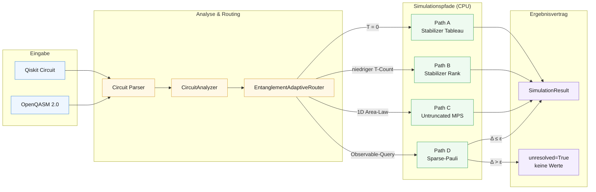
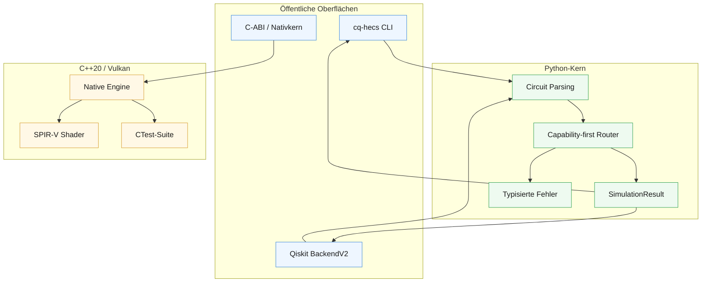

<div align="center">


# CQ-HECS

**Classical Quantum High-Efficiency Compute Simulator**

Vier klassische Simulationspfade. Ein ehrlicher Vertrag. Keine erfundenen Ergebnisse.

[](https://github.com/timfromhcs/CQ-HECS/actions/workflows/ci.yml)
[](https://github.com/timfromhcs/CQ-HECS/releases)
[](https://www.python.org/)
[](https://isocpp.org/)
[](https://qiskit.org/)
[](LICENSE)

[Quick Start](#-quick-start) ·
[Architektur](#-architektur) ·
[Pfade](#-die-vier-simulationspfade) ·
[Verifikation](#-verifikation) ·
[Dokumentation](#-dokumentation) ·
[Contributing](CONTRIBUTING.md)

</div>

---

## Warum CQ-HECS?

CQ-HECS ist kein weiterer „ein Algorithmus für alles“-Simulator. Es ist ein
**router-basierter klassischer Quantenschaltungsemulator**, der für jede
Schaltungsklasse den passenden Pfad wählt — und an der Grenze lieber
`unresolved=True` meldet, als ein plausibles Ergebnis zu erfinden.

| Prinzip | Umsetzung |
| :--- | :--- |
| **Keine stillen Approximationen** | Kein heimlicher Bond-Dimension-Cutoff. Verworfene Spektralmasse wird berichtet; wo keine gültige Schranke existiert, steht `None`. |
| **Keine erfundenen Resultate** | Nicht gemessene Counts werden nicht ausgegeben. Unbekannte Gatter werden typisiert abgelehnt, nicht als Identität behandelt. |
| **Fehlerschranken mit Namen** | `error_bound`, `numerical_error_bound` und `sampling_error_bound` sind getrennte Größen mit getrennten Metriken. |
| **Fail-closed statt fail-open** | Ungültiges OpenQASM, unbekannte Gates und Ressourcenüberschreitungen führen zu strukturierten Fehlern — nie zu einer Teilausführung. |
| **Ehrliche Hardware-Aussagen** | Alle vier Python-Pfade rechnen auf der CPU. Physische GPU-Beschleunigung ist **nicht verifiziert** und wird nicht behauptet. |

> **Status:** `v2.2.2` ist ein Patch-Release auf `v2.2.1`. Es beseitigt
> Erfolgsmeldungen ohne echte Zustandsevolution in den nativen Referenz- und
> Legacy-Flächen: Der Vulkan-Engine-Planer lehnt Gates/Sampling ab, VRTS-300
> prüft die GHZ-Korrelation und sampelt geseedet, Statevector und MPS sampeln
> nach der Born-Regel, und der QASM-Bytecode lehnt Qubit-Indizes > 255 ab,
> statt sie still abzuschneiden. Es fügt **keinen neuen Simulator und keine
> GPU-Beschleunigung** hinzu.
> Details: [Release Notes](RELEASE_NOTES.md) · [Changelog](CHANGELOG.md).

---

## Inhaltsverzeichnis

- [Warum CQ-HECS?](#warum-cq-hecs)
- [Quick Start](#-quick-start)
- [Die vier Simulationspfade](#-die-vier-simulationspfade)
- [Architektur](#-architektur)
- [OpenQASM-Vertrag](#-openqasm-vertrag)
- [Installation](#-installation)
- [Nutzung](#-nutzung)
- [Python-API](#-python-api)
- [Verifikation](#-verifikation)
- [Hardware-Support-Matrix](#-hardware-support-matrix)
- [Grenzen und Nicht-Ziele](#-grenzen-und-nicht-ziele)
- [Projektstruktur](#-projektstruktur)
- [Dokumentation](#-dokumentation)
- [Contributing](#-contributing)
- [Zitieren](#-zitieren)
- [Lizenz](#-lizenz)

---

## 🚀 Quick Start

### Python-Paket (CPU, kein Vulkan nötig)

```bash
git clone https://github.com/timfromhcs/CQ-HECS.git
cd CQ-HECS
python -m venv .venv
source .venv/bin/activate          # Windows: .\.venv\Scripts\Activate.ps1
pip install --upgrade pip
pip install -e .
```

```bash
cq-hecs doctor
cq-hecs run name:bell --shots 1000 --seed 42
cq-hecs --format json run name:bell --shots 1000
```

### Qiskit BackendV2

```python
from qiskit import QuantumCircuit
from cqhecs.backend import CQHecsBackend

backend = CQHecsBackend(num_qubits=100)
qc = QuantumCircuit(100)
qc.h(0)
for i in range(99):
    qc.cx(i, i + 1)
qc.measure_all()

result = backend.run(qc, shots=1000).result()
print(result.get_counts())
```

### Nativkern (optional)

Der C++20-Kern wird separat gebaut und benötigt das Vulkan SDK:

```bash
cmake -B build -DCMAKE_BUILD_TYPE=Release -DCQ_BUILD_TESTS=ON
cmake --build build --config Release
ctest --test-dir build -C Release --output-on-failure
```

---

## 🧭 Die vier Simulationspfade



| Pfad | Methode | Am besten für | Garantie | Harte Grenze |
| :--- | :--- | :--- | :--- | :--- |
| **A** | Gottesman-Knill-Tableau | reine Clifford-Schaltungen ($T=0$) | exakt, GF(2)-symplektisch, `error_bound = 0.0` | das erste nicht-Clifford-Gatter eskaliert |
| **B** | Stabilizer-Rank-Zerlegung | niedriger $T$-Count | exakte Algebra, float64-Auswertung | 22 Qubits (Implementation-Deckel) |
| **C** | Untruncated MPS | 1D Area-Law | keine bewusste Truncation; `numerical_error_bound=None` | Speicherbudget (`ram_budget_mb`, fail-closed); dichte Zustandskonversion ≤ 20 Qubits; Sampling-Routingdeckel 500 Qubits |
| **D** | Sparse-Pauli-Heisenberg | Observable-Queries auf 200+ Qubits | zertifizierte Schranke $\Delta \le \sum_{P \in \mathcal{D}} \lvert c_P \rvert$ | keine zertifizierte gemeinsame Messverteilung |

### Ergebniszustände

Jedes `SimulationResult` trägt einen maschinenlesbaren Zustand:

| Zustand | Bedeutung |
| :--- | :--- |
| `EXACT` | Keine bewusste Näherung angewendet. Die Arithmetikklasse steht separat in `numerical_mode`. |
| `CERTIFIED` | Zertifizierte Näherung mit Schranke über die tatsächlich zurückgegebene Größe. |
| `UNRESOLVED` | Grenze überschritten; die Simulation verweigert das Raten und liefert keine Werte. |
| `FAILED` | Technischer Fehler; nie „erfolgreich aussehend“. |

> `exact=True` bedeutet **nicht** „symbolisch exakte Arithmetik“. Es bedeutet:
> kein bewusster Approximationsschritt. Die float64-Klasse ist auf jedem
> Resultat über `numerical_mode` ausgewiesen.

---

## 🏗️ Architektur



**Komponenten:**

- **Python-Kern** (`cqhecs/`): Parser, Analyzer, Router, vier Backends und der
  gemeinsame Ergebnisvertrag.
- **CLI** (`cq-hecs`): `version`, `doctor`, `backend list`, `analyze`, `run`,
  `verify`, `benchmark smoke`; strikter JSON-Vertrag.
- **Nativkern** (`src/`, `include/`, `shaders/`): C++20-Engine, C-ABI und
  Vulkan-Compute-Shader. Separat gebaut und getestet.
- **Legacy-Schicht** (`python_bridge/`, `python/`): historische Referenz- und
  Diagnostikmodule; nicht der unterstützte Einstiegspunkt.

---

## 📜 OpenQASM-Vertrag

Der Python-Parser und der native QASM-Pfad sind **fail-closed** und teilen
denselben dokumentierten Vertrag: strukturierte `{line, category, message}`-
Fehler, globale Qubit-Offsets für mehrere Register, Ganzregister-Expansion und
eine begrenzte Winkelgrammatik ohne `eval()`. Die vollständige Spezifikation
inklusive der bewusst unterschiedlichen Gate-Obergrenzen steht in
[`docs/QASM_CONTRACT.md`](docs/QASM_CONTRACT.md).

```text
OPENQASM 2.0;
include "qelib1.inc";
qreg q[2];
creg c[2];
h q[0];
cx q[0], q[1];
measure q[0] -> c[0];
```

| Eingabe | Verhalten |
| :--- | :--- |
| Gültige, unterstützte Anweisung | wird ausgeführt |
| Fehlendes Semikolon | strukturierter Parse-Fehler |
| Unbekanntes Gatter | `unsupported_gate`, keine Ausführung |
| Nicht-endlicher/ungültiger Winkel | `invalid_parameter` |
| Nicht deklariertes Register | strukturierter Parse-Fehler |
| `qreg a[2]; qreg b[3];` | globale Offsets: `a[0..1]=0..1`, `b[0..2]=2..4` |
| Mid-Circuit-Messung / `reset` / `if` | vor Ausführung abgelehnt |
| Überschrittenes `--qubits`-Limit | Ablehnung, Exit-Code `2` |

- `cq_hecs qasm` (Nativ-Executable): **Exit-Code 2** bei ungültiger Eingabe.
- `--json`: genau ein JSON-Dokument auf stdout, Diagnostik auf stderr.
- C-ABI `cq_execute_qasm`: **`-3`** bei Parse-Fehlern, Ergebnis wird genullt.
- Native Klassifikation: `engine_class = legacy_z8_phase_ledger`,
  `statevector_simulation = false`.
- Der native Executor kennt nur seinen in §5 des QASM-Vertrags dokumentierten
  Gate-Satz; `p/u1/cu1/crx/cry/crz` sind Python/Path-C-only. Keine Eingabe wird
  von einem Parser akzeptiert und vom anderen mit anderer Semantik ausgeführt.

---

## 📦 Installation

### Voraussetzungen

| Komponente | Anforderung |
| :--- | :--- |
| Python | 3.11–3.14 |
| Betriebssystem | Linux x64, Windows 10/11 |
| Vulkan SDK | nur für den optionalen Nativkern |
| Compiler | C++20 (GCC/Clang/MSVC) |

### Linux (Ubuntu 22.04 / 24.04)

```bash
sudo apt-get update
sudo apt-get install -y cmake ninja-build g++ libvulkan-dev glslang-tools vulkan-tools

python3 -m venv .venv
source .venv/bin/activate
pip install --upgrade pip
pip install -r requirements.txt
pip install -e .
```

### Windows 10 / 11 (PowerShell)

```powershell
choco install vulkan-sdk cmake ninja -y --no-progress

python -m venv .venv
.\.venv\Scripts\Activate.ps1
pip install --upgrade pip
pip install -r requirements.txt
pip install -e .
.\build.bat        # Nativkern (optional)
```

### Wheel / sdist

```bash
python -m build
# dist/cqhecs-2.2.2-py3-none-any.whl
# dist/cqhecs-2.2.2.tar.gz
```

Die veröffentlichten Artefakte, Checksums und die SPDX-SBOM stehen im
[Release v2.2.2](https://github.com/timfromhcs/CQ-HECS/releases/tag/v2.2.2).

---

## 🛠️ Nutzung

### CLI-Übersicht

| Befehl | Zweck |
| :--- | :--- |
| `cq-hecs version` | Version und Laufzeitumgebung |
| `cq-hecs doctor` | OS, Python, Native-Binding, Vulkan-Stufen |
| `cq-hecs backend list` | Fähigkeiten und Gate-Sets der Pfade A–D |
| `cq-hecs analyze name:ghz8` | statische Analyse und Pfadempfehlung |
| `cq-hecs run name:bell --shots 1000` | Schaltung ausführen |
| `cq-hecs verify name:bell --reference aer` | gegen Referenz vergleichen |
| `cq-hecs benchmark smoke` | reproduzierbarer Smoke-Benchmark |

`--format json` ist eine **globale** Option und muss vor dem Unterbefehl stehen:

```bash
cq-hecs --format json run name:bell --shots 1000
```

Exit-Codes der Python-CLI: `0` Erfolg, `1` unerwarteter Fehler, `2`
Verwendungsfehler, `3` unresolved, `4` Umgebung nicht verfügbar. Der native
`qasm`-Befehl nutzt zusätzlich `2` für ungültige Schaltungseingaben.

### Referenzschaltungen

`bell`, `bell_measured`, `clifford6`, `ghz8`, `ghz8_measured`, `ghz16`,
`low_t_rank4`, `mps6`, `sparse_pauli4`

### Router

```python
from qiskit import QuantumCircuit
from cqhecs.router import EntanglementAdaptiveRouter

router = EntanglementAdaptiveRouter(error_tolerance=0.01)

qc = QuantumCircuit(4)
qc.h(0)
qc.t(0)
qc.cx(0, 1)

result = router.route_and_execute(qc, shots=1000)
print(result.path, result.exact, result.error_bound, result.unresolved)
```

Der Router ist fail-closed: erzwungene Pfade werden nicht still umgeleitet;
nur typisierte Capability- oder Ressourcenfehler lösen eine Eskalation aus.

### Pfad D explizit

```python
from qiskit import QuantumCircuit
from cqhecs.backends import PathDSparsePauliBackend

qc = QuantumCircuit(3)
qc.h(0)
qc.cx(0, 1)
qc.t(0)
qc.cx(0, 2)

backend = PathDSparsePauliBackend(max_pauli_terms=512)
result = backend.execute(qc, shots=100)

print(result.expectation_values)
print(result.error_bound)
```

Gemeinsame Counts sind opt-in über `allow_uncertified_joint_counts=True` und
werden als **keine** gemeinsame Verteilung markiert
(`counts_are_joint_distribution=False`).

---

## 🐍 Python-API

### Qiskit BackendV2

```python
from qiskit import QuantumCircuit
from cqhecs.backend import CQHecsBackend

backend = CQHecsBackend(num_qubits=100)
print(backend.backend_version)  # == cqhecs.__version__

qc = QuantumCircuit(100)
qc.h(0)
for i in range(99):
    qc.cx(i, i + 1)
qc.measure_all()

counts = backend.run(qc, shots=1000).result().get_counts()
```

Die klassische Bit-Abbildung folgt der Qiskit-Konvention: Qubit 0 steht
rechtsbündig im hinten angehängten klassischen Register. Das Verhalten ist
gegen Aer getestet.

### Fehler und Grenzen

```python
from cqhecs.result import SimulationState

result = backend.run(qc, shots=1000).result()
if result.unresolved:
    raise RuntimeError("Simulation unresolved: " + ", ".join(result.diagnostics))
```

Unbekannte Gates, ungültige QASM-Eingaben und Ressourcenüberschreitungen
liefern typisierte Fehler. Es gibt keinen stillen Fallback auf Pfad A und keine
erfundenen 50/50-Counts.

---

## ✅ Verifikation

Die folgenden Zahlen sind lokale Messungen für den `v2.2.2`-Kandidaten, keine
Leistungsbenchmarks. CI-Ergebnisse werden für den exakt gepushten SHA separat
in [`research/next_stable/TEST_MATRIX.md`](research/next_stable/TEST_MATRIX.md)
festgehalten; [`research/v2_2/TEST_MATRIX.md`](research/v2_2/TEST_MATRIX.md)
bleibt der historische Nachweis für `v2.2.1`.

| Gate | Ergebnis |
| :--- | :--- |
| CTest (MSVC Release) | **17/17 bestanden** |
| Python-Suite (CPython 3.14 + Nativkern) | **311 bestanden** |
| Python-Suite (CPython 3.11, gepinnte Abhängigkeiten, ohne Nativkern) | im CI-Matrixjob; native Tests skippen dort sichtbar |
| Mutation-Harness | **11/11 Mutanten erkannt**, Baseline sauber |
| Branch-Coverage | **81 %** lokal; CI-Schwelle **70 %** |
| Shader-Verifikation | **12/12** SPIR-V-Shader |
| Version-Konsistenz | alle Flächen melden `2.2.2` |
| Silent-Truncation-Audit | keine Muster gefunden |
| GitHub Actions | Linux/Windows nativ, ASan/UBSan, Python 3.12–3.14, Package-Smoke |
| Physische GPU | **nicht verifiziert** |
| Google Cloud Build | **nicht verifiziert** (keine Projekt-/Credential-Verifikation in der Audit-Umgebung) |

### Selbst prüfen

```bash
# Native
cmake --build build --config Release
ctest --test-dir build -C Release --output-on-failure

# Python (native Tests dürfen nicht skippen)
CQ_HECS_REQUIRE_NATIVE=1 pytest tests/ -q

# Verträge und Audit
python scripts/check_version.py
python scripts/verify_no_silent_truncation.py
python scripts/verify_vulkan_shaders.py
python scripts/run_mutation_tests.py
```

> Ein grüner Lauf auf einem älteren Commit ist kein Beweis für einen späteren
> Commit. Die vollständige Evidenz steht in
> [`research/v2_2/TEST_MATRIX.md`](research/v2_2/TEST_MATRIX.md).

---

## 🖥️ Hardware-Support-Matrix

| Plattform / GPU | Vulkan / Compute API | Verifikationsstufe | Status |
| :--- | :--- | :---: | :--- |
| Ubuntu Linux x64 + Mesa Lavapipe | Vulkan 1.3 SPIR-V (Software) | `CI_VERIFIED` | Shader- und Pipeline-Konformität in GitHub Actions; **keine physische GPU** |
| Windows Headless CI | Headless-Fallback / Null-Device-Guard | `CI_VERIFIED` | GitHub Actions (`windows-latest`) |
| Lokale Windows-Workstation | Vulkan 1.4 Loader | `LOADER_VERIFIED` | Loader enumeriert ein Gerät; **kein Compute-Dispatch nachgewiesen** |
| Apple Silicon (M1–M4) | MoltenVK / Metal | `NOT_VERIFIED` | kein Test |
| Intel Arc / NVIDIA / AMD diskret | Vulkan 1.3 Treiber | `NOT_VERIFIED` | kein Test |

> **Wichtig:** Der Python-Pfad (Paket, CLI, alle vier Pfade) rechnet
> ausschließlich auf der **CPU**. Shader-Kompilierung und Software-Vulkan
> belegen Integrationsverhalten, **nicht** physische GPU-Beschleunigung und
> **keine** herstellerübergreifende Kompatibilität.

---

## ⚠️ Grenzen und Nicht-Ziele

- **Kein universeller Quantensimulator.** Jeder Pfad hat eine dokumentierte
  Zielklasse und eine harte Grenze.
- **Kein GPU-Beschleunigungsversprechen.** Physische GPU-Ausführung ist nicht
  verifiziert.
- **Kein Brechen voller kryptografischer Primitive.** Die ARX-/SAT-Module sind
  eine Testbench für reduzierte Runden, keine Preimage-Inversion für 256-Bit-
  Vollversionen.
- **Keine zertifizierte gemeinsame Messverteilung in Pfad D.** Die Schranke
  gilt für die angefragten Observablen.
- **Keine symbolische Exaktheit in Pfad B/C.** Die Zerlegung ist algebraisch
  exakt, die Auswertung erfolgt in float64.
- **Keine dynamischen Schaltungen.** Mid-Circuit-Messung, `reset` und
  klassisch bedingte Gates werden vor der Ausführung abgelehnt; sie werden
  weder simuliert noch stillschweigend ans Ende verschoben.
- **Path-D-Samples sind Randverteilungen.** Sie sind keine zertifizierte
  gemeinsame Bitstring-Verteilung; die Schranke gilt nur für die angefragten
  Observablen.
- **`exact=True` ist keine symbolische Exaktheit.** Numerische
  Rangreduktion (relative Schwelle `1e-13`) und float64-Rundung bleiben
  bestehen; ein zertifizierter MPS-Fehlerbund wird nicht behauptet.
- **500 MPS-Qubits sind ein Routingdeckel, keine Exaktheitsgarantie.**
  Entscheidend sind Verschränkung, tatsächliche Bond-Dimension und Speicher.
- **Python- und Native-Parser haben unterschiedliche Gate-Obergrenzen.**
  Beide lehnen nicht implementierte Gates ab; die Python-Seite kennt zusätzlich
  die Path-C-Gates. Details: [`docs/QASM_CONTRACT.md`](docs/QASM_CONTRACT.md) §6.
- **Kein Cloud-Build-Nachweis in diesem Audit.** `cloudbuild.yaml` ist
  vorhanden, wurde aber ohne verifizierten Projekt-/Credential-Zugang nicht
  beobachtet.

---

## 📁 Projektstruktur

```text
CQ-HECS/
├── cqhecs/                 # Python-Kern: Parser, Router, vier Backends
├── python_bridge/          # Legacy-Referenz- und Diagnostikschicht
├── src/                    # C++20-Nativkern und C-ABI
├── include/                # Öffentliche C-/C++-Header
├── shaders/                # Vulkan-Compute-Shader (GLSL)
├── tests/                  # Python- und C++-Tests
├── docs/                   # API-, Architektur-, QASM- und Nutzungsdokumente
├── research/               # Audit-, Methoden- und Verifikationsevidenz
├── benchmarks/             # Reproduzierbare Smoke-Benchmark-Rohdaten
├── scripts/                # Version-, Audit-, Build- und Release-Werkzeuge
└── .github/workflows/      # CI, Nightly und Release-Pipeline
```

---

## 📚 Dokumentation

| Dokument | Inhalt |
| :--- | :--- |
| [`ARCHITECTURE.md`](ARCHITECTURE.md) | verbindliche Architekturübersicht |
| [`docs/ARCHITECTURE.md`](docs/ARCHITECTURE.md) | Komponentenmatrix und Verifizierungsstufen |
| [`docs/QASM_CONTRACT.md`](docs/QASM_CONTRACT.md) | Parser-Grammatik, Fehlerkategorien, Exit-Codes |
| [`docs/API_REFERENCE.md`](docs/API_REFERENCE.md) | CLI-, Python- und C-ABI-Verträge |
| [`docs/USAGE_GUIDE.md`](docs/USAGE_GUIDE.md) | geprüfte Kommandos und Nutzung |
| [`docs/EMBEDDING_GUIDE.md`](docs/EMBEDDING_GUIDE.md) | C-ABI-Einbettung in C++, Python, C#, Rust |
| [`docs/BENCHMARKS.md`](docs/BENCHMARKS.md) | aktuelle und historische Benchmarks |
| [`docs/V2_IMPLEMENTATION_MATRIX.md`](docs/V2_IMPLEMENTATION_MATRIX.md) | Implementierungsstatus mit Test-Ankern |
| [`research/v2_2/BASELINE.md`](research/v2_2/BASELINE.md) | Audit-Ausgangslage und behobene Befunde |
| [`research/v2_2/TEST_MATRIX.md`](research/v2_2/TEST_MATRIX.md) | lokale Gates, CI-Matrix und offene Punkte |
| [`CHANGELOG.md`](CHANGELOG.md) · [`RELEASE_NOTES.md`](RELEASE_NOTES.md) | Versionsgeschichte und Release-Details |

---

## 🤝 Contributing

Beiträge sind willkommen — besonders reproduzierbare Fehlerberichte,
Korrektheitsgegenbeispiele und Tests, die eine bisher ungetestete Grenze
abdecken.

1. Forke das Repository und erstelle einen Branch.
2. Installiere die Entwicklungsabhängigkeiten: `pip install -e ".[dev]"`.
3. Führe die relevanten Gates aus (siehe [Verifikation](#-verifikation)).
4. Öffne einen Pull Request mit Reproduktionsschritten und Testergebnissen.

Bitte beachte den Grundsatz dieses Projekts: **keine grünen Tests auf Kosten
der Wahrheit**. Ein Test, der eine falsche Aussage bestätigt, ist ein Bug.

- [CONTRIBUTING.md](CONTRIBUTING.md)
- [Issue Templates](.github/ISSUE_TEMPLATE)
- Sicherheitslücken bitte **nicht** öffentlich melden: [SECURITY.md](SECURITY.md)

---

## 📝 Zitieren

Wenn du CQ-HECS in Forschung oder Lehre verwendest, zitiere bitte das
Repository. GitHub bietet über [`CITATION.cff`](CITATION.cff) einen
„Cite this repository“-Eintrag an.

```bibtex
@software{cqhecs2026,
  author  = {Stark, Tim Johann},
  title   = {CQ-HECS: Classical Quantum High-Efficiency Compute Simulator},
  version = {2.2.2},
  year    = {2026},
  url     = {https://github.com/timfromhcs/CQ-HECS},
  license = {Apache-2.0}
}
```

---

## ⚖️ Lizenz

CQ-HECS ist lizenziert unter der **Apache License 2.0**.
Siehe [LICENSE](LICENSE) für den vollständigen Lizenztext.

<div align="center">

**[⬆ nach oben](#cq-hecs)**

</div>
