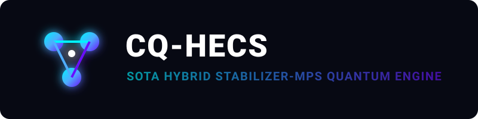
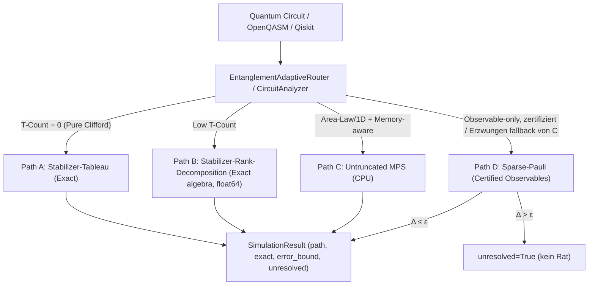

<p align="center">
  
</p>

<p align="center">
  <a href="https://github.com/timfromhcs/CQ-HECS/actions/workflows/ci.yml"></a>
  <a href="https://isocpp.org/"></a>
  <a href="https://www.python.org/"></a>
  <a href="scripts/verify_no_silent_truncation.py"></a>
  <a href="https://qiskit.org/"></a>
  <a href="LICENSE"></a>
</p>

---

## 1. Überblick

**CQ-HECS** (Classical Quantum High-Efficiency Compute Simulator) ist ein klassischer Quantenschaltungsemulator mit einer geprüften **Four-Path-Architektur**, einer `cq-hecs`-CLI mit festem JSON-Vertrag, Qiskit-BackendV2-Integration und einem eigenständigen C++20/Vulkan-Nativkern. Alle vier Simulationspfade rechnen **ausschließlich auf der CPU**; der Nativkern ist ein separat gebautes, separat getestetes Artefakt.

Das Versprechen dieses Projekts ist **nicht** universelle effiziente Simulation, sondern:

- **Keine stillen Approximationen.** Bindungsdimensionen werden nie heimlich abgeschnitten. Wo eine Grenze erreicht wird, eskaliert das Ergebnis oder wird als `unresolved=True` markiert — niemals geraten.
- **Keine erfundenen Resultate.** Zählungen, die nicht wirklich gemessen wurden, werden nicht ausgegeben; unbekannte Gatter werden mit typisiertem Fehler abgelehnt, nicht als Identität behandelt.
- **Fehlerschranken mit Namen.** `error_bound` (bewusste Näherung), `numerical_error_bound` (numerische Diagnostik) und `sampling_error_bound` (endliche Stichprobe) sind getrennt. Wo keine gültige Schranke ableitbar ist, steht `None` — keine Zahl zum Schein.
- **Ehrliche Grenzen.** Keine Aussage über Bereiche, die nicht tatsächlich gemessen oder bewiesen wurden; die Hardware-Verifikationsstufen sind je Plattform ausgewiesen ([§8](#8-hardware-support-matrix--verifikationsstufen)).

---

## 2. Fähigkeiten und Grenzen

| Domäne / Schaltungsklasse | Was CQ-HECS kann (verifiziert) | Was CQ-HECS nicht kann (Grenzen) |
| :--- | :--- | :--- |
| **Reine Clifford-Schaltungen ($T = 0$)** | Exakte Simulation über das Gottesman-Knill-Tableau (GF(2)-symplektische Arithmetik); polynomielle Zeit- und Speicherskalierung; 300+ Qubits GHZ- und Stabilizer-Schaltungen mit 1.000+ echten Stichproben über Pfad A. | Kein universeller Simulator: das erste nicht-Clifford-Gatter verlangt einen anderen Pfad. |
| **Niedriger $T$-Count** | Pfad B: exakte Stabilizer-Rank-Zerlegung der nicht-Clifford-Gatter (kein Term wird gestrichen), Auswertung in IEEE-754 float64. Implementierter Deckel: **22 Qubits** (Implementation-Deckel, kein Theorem). | Skaliert exponentiell mit dem T-Count ($O(2^{\alpha T})$); tiefe zufällige Clifford+T-Schaltungen übersteigen jedes Rangbudget. |
| **1D Area-Law Verschränkung** | Pfad C: untruncated MPS — die Bindungsdimension wächst zur vollen numerischen Rangstufe; SVD verwirft nur Werte unterhalb der Relativschwelle (1e-13 × σ_max); natives sequentielles Sampling skaliert ohne dichten $2^n$ Zustandsvektor auf 200–300+ Qubits (z. B. 300Q GHZ in < 0,3s). Dichte Zustandskonversion bleibt auf ≤ 20 Qubits gedeckelt. | Keine effiziente Repräsentation für dichte 2D-/3D-Verschränkung; χ kann exponentiell wachsen. |
| **Volume-Law / tiefe Zufallsschaltungen** | Pfad C eskaliert bei Speichergrenze transparent auf Pfad D oder markiert `unresolved=True`. | Kein Brechen von BQP ≠ BPP: Random Circuit Sampling bleibt klassisch nicht verlustfrei in Polynomialzeit simulierbar. |
| **Zertifizierte Observable-Näherung (Pfad D)** | Heisenberg Sparse-Pauli-Dynamics mit bewiesener Schranke $\Delta \le \sum_{P \in \mathcal{D}} |c_P|$ für angefragte Observablen ($\langle Z_q \rangle$, $\langle Z_q Z_r \rangle$); selektive Observablen-API zur gezielten Auswertung auf 200+ Qubits ohne Paar-Explosion; `unresolved=True` ohne Werte bei Schrankenüberschreitung. | Keine zertifizierte Schranke auf einer gemeinsamen Messverteilung; gemeinsame Counts nur opt-in und als keine gemeinsame Verteilung markiert. |
| **ARX & Krypto-Testbench** | Algebraische SAT-Analyse für reduzierte Runden von ChaCha20 (20-Runden-Spezifikation), SHA-256 (64 Schritte) und BLAKE2b (12 Runden). | **Kein Brechen voller kryptografischer Primitives** — keine Preimage-Inversion für 256-Bit-Vollverschlüsselungen. |
| **Endliche Stichproben** | Der Stichprobenfehler ist eine supportgrößen-abhängige Konzentrationsschranke (Weissman et al. 2003): $\mathrm{TV} \le \sqrt{\ln((2^K - 2)/\delta)/(2n)}$; bei $K = 2$ exakt der klassische Hoeffding-Wert; in Log-Domäne berechnet (kein Overflow bei großen $K$). | Keine dimensionsfreie Schranke auf beliebigen Supportgrößen; bei sehr großem $K$ wird die Schranke ehrlicherweise trivial (nahe 1). |

---

## 3. Four-Path-Architektur



### Spezifikation der Pfade

| Pfad | Methode | Zielklasse | Algebra | Fehlerschranke | Ressourcengrenze | Verhalten an der Grenze |
| :--- | :--- | :--- | :--- | :--- | :--- | :--- |
| **A** | Stabilizer-Tableau | Reines Clifford ($T = 0$) | GF(2)-symplektisch, exakt | $0{,}0$ (keine Approximation) | polynomiell $O(N^2)$; 300+ Qubits GHZ mit 1.000+ Shots | Nicht-Clifford-Gatter → typisierte Ablehnung (kein stilles Ignorieren) |
| **B** | Stabilizer-Rank | Niedriger $T$-Count | exakte Zerlegung, Auswertung float64 | exakte Algebra; numerische Diagnostik separat | $O(2^{\alpha T})$ Zweige; **22-Qubit-Deckel** | Deckel-/Gate-Überschreitung → typisierter Fehler (keine Fake-Counts) |
| **C** | MPS | 1D Area-Law | float64; SVD nur unterhalb der Relativschwelle | `numerical_error_bound=None`; `discarded_spectral_mass_diagnostic` | Speicherbudget; natives Sampling bis 500 Qubits (dense to_statevector ≤ 20 Qubits) | Budget → kohärenter Abbruch, dann D/unresolved; Sampling-Grenze → keine Counts statt Platzhalter |
| **D** | Sparse-Pauli | Observable-Queries | Konjugation in der $X^x Z^z$-Basis (Tabelle gegen explizite Matrizen geprüft) | $\Delta \le \sum_{P \in \mathcal{D}} \|c_P\|$ | Pauli-Termbudget K; 200+ Qubits via selektiver Observablen-API | $\Delta > \epsilon$ → sofort `unresolved=True`, ohne Werte |

### Explizite Simulationszustände (`SimulationState`)

Jedes `SimulationResult` trägt einen verbindlichen, maschinenlesbaren Zustand:

| Zustand (`SimulationState`) | Kriterien | Bedeutung |
| :--- | :--- | :--- |
| `EXACT` | `exact == True`, kein bewusster Näherungsschritt | Algebraisch exakt; die float64-Fehlerklasse ist über `numerical_mode` separat ausgewiesen (Pfad A, B, untruncated C). |
| `CERTIFIED` | `not exact` und `not unresolved` | Zertifizierte Näherung mit bewiesener Schranke über die tatsächlich zurückgegebene Größe (Pfad D). |
| `UNRESOLVED` | `unresolved == True` oder $\Delta > \epsilon_{\text{tol}}$ | Schaltung überschreitet Verschränkungs-, Speicher- oder Toleranzgrenzen. Die Simulation verweigert das Raten und liefert keine Werte. |
| `FAILED` | Ausnahme / Validierungsfehler | Technischer Fehler in Ausführung oder Pipeline; nie „erfolgreich aussehend". |

Wichtig: `exact=True` heißt **keine bewusste Näherung angewendet**,
nicht *(mathematisch exakte Arithmetik)*. Die Arithmetik-Klasse ist auf jedem
Resultat über `numerical_mode` explizit benannt (z. B.
`exact-symplectic-gf2`, `float64-exact-decomposition`, `float64-untruncated-mps`,
`float64-heisenberg-certified`).

---

## 4. Mathematische Grundlagen

### Pfad A: Gottesman-Knill-Tableau
Clifford-Gatter ($H, S, CX, CZ, SWAP$) bilden Pauli-Operatoren bijektiv ab:

$$U^\dagger P U = P' \in \mathcal{P}_n$$

Der Zustand wird über ein binäres symplektisches Tableau (Aaronson-Gottesman) verlustfrei nachverfolgt. Die Arithmetik ist vollständig ganzzahlig — kein Gleitkommawert beteiligt, weshalb `error_bound = 0.0` hier eine algebraische Aussage ist.

### Pfad B: Stabilizer-Rank-Zerlegung
Nicht-Clifford-Rotationen ($T$, T†, RX, RY, RZ/P/U1 mit den korrekt zugeteilten Clifford-Generatoren X/Y/Z) werden in eine endliche Summe von Clifford-Zweigen zerlegt — kein Term wird weggestrichen:

$$|\psi\rangle = \sum_{j=1}^{2^{\alpha t}} c_j |s_j\rangle, \qquad |s_j\rangle \text{ Clifford}$$

Die Zerlegung selbst ist mathematisch exakt; die Auswertung nutzt IEEE-754 float64 und ist als `numerical_mode = float64-exact-decomposition` benannt. Der Sampling-Fehler wird separat über die supportgrößen-abhängige Schranke berichtet.

### Pfad C: Untruncated MPS (Area-Law)
Bei zwei-Qubit-Kontraktionen wird eine SVD auf dem zweistelligen Block berechnet:

$$M = U S V^\dagger$$

Es gibt **keine Budget-Truncation**: die Bindungsdimension wächst zur vollen numerischen Rangstufe. Die Rangwahl verwirft nur Werte unterhalb einer relativen Rundungsschwelle (1e-13 × σ_max) — eine Gleitkomma-Aussage, keine mathematische Approximation. Die verworfene Spektralmasse ist als `discarded_spectral_mass_diagnostic` gemeldet, aber sie ist **keine** zertifizierte Schranke für die zurückgegebenen Amplituden; `numerical_error_bound` bleibt deshalb `None`.

### Pfad D: Zertifizierte Pauli-Fehlerschranke
Observablen werden in der Heisenberg-Darstellung rückwärts evolviert: $O(t) = U^\dagger O U = \sum_P c_P P$.

Werden Operatoren mit kleinen Koeffizienten verworfen ($\mathcal{D}$), gilt über die Dreiecksungleichung und $\|P\|_\infty = 1$:

$$\left|\langle O_{\text{exact}}\rangle - \langle O_{\text{approx}}\rangle\right| \le \sum_{P \in \mathcal{D}} |c_P| = \Delta_{\text{trunc}}$$

Diese Schranke gilt **nur für die angefragten Observablen**, nicht für eine gemeinsame Messverteilung. Sobald $\Delta_{\text{trunc}}$ die Toleranz überschreitet, wird sofort `unresolved=True` **ohne Werte** gemeldet.

### Endliche Stichproben: Support-abhängige Konzentrationsschranke
Für eine kategoriale Verteilung mit Stützgröße $K$ (Anzahl möglicher Ausgänge), gemessen mit $n$ Shots, gilt die L1-Konzentration nach Weissman et al. (2003); mit TV $= \|\hat P - P\|_1 / 2$:

$$\mathrm{TV}(\hat{P}, P) \le \sqrt{ \ln\!\left(\frac{2^K - 2}{\delta}\right) / (2 n) } \quad \text{mit Wahrscheinlichkeit } \ge 1 - \delta$$

Bei $K = 2$ reduziert sich die Schranke exakt auf den klassischen Hoeffding-Wert $\sqrt{\ln(2/\delta)/(2n)}$. Der Faktor $(2^K-2)$ zählt die nicht-trivialen Teilmengen-Ereignisse des Supports (Alphabetgröße im Weissman-Bound). Wächst $K$, wird die Schranke groß — das wird ehrlich mitberichtet, nicht kaschiert. Die Schranke wird in Log-Domäne berechnet (kein Overflow) und bei 1.0 so angeklippt, dass sie als Wahrscheinlichkeitsabstand gültig bleibt.

---

## 5. Installation & Setup

### 5.0 Nur Python (kein Vulkan erforderlich)
Das Python-Paket, die `cq-hecs`-CLI und alle vier Pfade laufen **ausschließlich
auf der CPU** und benötigen **kein Vulkan-SDK**:

```bash
pip install .             # aus dem Projektverzeichnis (Checkout)
cq-hecs doctor
cq-hecs run name:bell --shots 1000 --format json
```

> Der Nativkern (`cq_hecs.exe` / `cq_hecs.dll` / `_cqhecs_core`) benötigt das
> Vulkan-SDK (die öffentlichen Header inkludieren `vulkan/vulkan.h`). Das
> betrifft nur den nativen Build — nicht die Python-Oberfläche.

### 5.1 Linux (Ubuntu 22.04 / 24.04)
```bash
# CMake/Ninja, C++-Compiler, Vulkan SDK (nur für den Nativkern)
sudo apt-get update
sudo apt-get install -y cmake ninja-build g++ libvulkan-dev glslang-tools vulkan-tools

git clone https://github.com/timfromhcs/CQ-HECS.git
cd CQ-HECS
python3 -m venv .venv
source .venv/bin/activate
pip install --upgrade pip
pip install -r requirements.txt
pip install -e .
```

### 5.2 Windows 10 / 11 (PowerShell)
```powershell
# Vulkan SDK via Chocolatey oder offiziellen Installer (nur für den Nativkern)
choco install vulkan-sdk cmake ninja -y --no-progress

git clone https://github.com/timfromhcs/CQ-HECS.git
cd CQ-HECS
python -m venv .venv
.\.venv\Scripts\Activate.ps1
pip install --upgrade pip
pip install -r requirements.txt
pip install -e .
.\build.bat        # Nativkern (optional)
```

### 5.3 Wheel / sdist bauen
```bash
python -m build
# => dist/cqhecs-2.0.0-py3-none-any.whl und dist/cqhecs-2.0.0.tar.gz
```

---

## 6. Workflow & Ausführung

### 6.1 CLI (`cq-hecs`)
```bash
cq-hecs version                        # Versionsinformation
cq-hecs doctor                         # Umgebung: OS, Python, Nativ-Binding, Vulkan-Stufen
cq-hecs backend list                   # Fähigkeiten und Gate-Sets der Pfade A-D
cq-hecs analyze name:ghz8              # statische Analyse + Pfadempfehlung
cq-hecs run name:bell --shots 1000 --seed 42
cq-hecs verify name:bell --reference aer
cq-hecs benchmark smoke                # reproduzierbarer Smoke-Benchmark
```

`--format json` schreibt **genau ein** JSON-Dokument auf stdout; Diagnosen gehen
immer an stderr. Exit-Codes: `0` Erfolg, `1` unerwarteter Fehler, `2`
Verwendungsfehler, `3` unresolved, `4` Umgebung nicht verfügbar.

Verfügbare Referenzschaltungen (`cq-hecs analyze name:<name>`): `bell`,
`bell_measured`, `clifford6`, `ghz8`, `ghz8_measured`, `ghz16`, `low_t_rank4`,
`mps6`, `sparse_pauli4`.

### 6.2 Vulkan Compute-Shader kompilieren & verifizieren
Kompiliert alle Vulkan-Compute-Shader mit `glslangValidator`:
```bash
python scripts/verify_vulkan_shaders.py
```

### 6.3 C++20 Core & Test-Suite bauen
```bash
cmake -B build -G Ninja -DCMAKE_BUILD_TYPE=Release -DCQ_BUILD_TESTS=ON
cmake --build build --config Release
ctest --test-dir build --output-on-failure
```

### 6.4 Python-Testsuite ausführen
```bash
pytest tests/ -ra                                        # vollständige Suite
pytest tests/test_correctness_contracts.py -v            # 4-Pfad-Korrekturregressionen
pytest tests/test_cli_contract.py -v                     # JSON-Reinheit, Exit-Codes
python scripts/check_version.py                          # Versionskonsistenz aller Flächen
python scripts/verify_no_silent_truncation.py            # Audit gegen Silent Cutoffs
python scripts/run_mutation_tests.py                     # Mutation harness (fail-closed)
```

### 6.5 Benchmarks ausführen
Reproduzierbarer Smoke-Benchmark — der Datensatz, an dem die aktuellen Claims
hinterlegt sind:
```bash
cq-hecs --format json benchmark smoke
```
Die Rohdaten liegen in [`benchmarks/smoke_results_current.json`](benchmarks/smoke_results_current.json); Provenienz (Commit, Version, Hardware, Abhängigkeiten) ist in [`docs/BENCHMARKS.md`](docs/BENCHMARKS.md) erfasst.

Die historischen Mess-Tabellen bleiben in [`docs/BENCHMARKS.md`](docs/BENCHMARKS.md) als **historisch/STALE** gekennzeichnet und werden nicht als v2-Messwerte gelesen.

---

## 7. Nutzung & Code-Beispiele

### 7.1 Qiskit BackendV2 Drop-In
```python
from qiskit import QuantumCircuit
from cqhecs.backend import CQHecsBackend

backend = CQHecsBackend(num_qubits=100)   # backend_version == cqhecs.__version__

qc = QuantumCircuit(100)
qc.h(0)
for i in range(99):
    qc.cx(i, i + 1)
qc.measure_all()

job = backend.run(qc, shots=1000)
result = job.result()
print(result.get_counts())
```

Klassische Bit-Abbildung: Bei `measure_all()` erscheint Qubit `q` rechtsbündig
innerhalb des hinten angehängten klassischen Registers (Qiskit-Konvention,
Qubit 0 am weitesten rechts) — das Verhalten ist gegen Aer getestet.

### 7.2 Router
```python
from qiskit import QuantumCircuit
from cqhecs.router import EntanglementAdaptiveRouter

router = EntanglementAdaptiveRouter(error_tolerance=0.01)

qc = QuantumCircuit(4)
qc.h(0); qc.t(0); qc.cx(0, 1)

res = router.route_and_execute(qc, shots=1000)
print(res.path, res.exact, res.error_bound, res.unresolved)
```

Der Router ist fail-closed: erzwungene Pfade werden nicht still umgeleitet;
nur typisierte Capability-/Ressourcenfehler lösen eine Eskalation aus —
keine willkürlichen `Exception`s.

### 7.3 Pfad D explizit
```python
from qiskit import QuantumCircuit
from cqhecs.backends import PathDSparsePauliBackend

qc = QuantumCircuit(3)
qc.h(0); qc.cx(0, 1); qc.t(0); qc.cx(0, 2)

backend = PathDSparsePauliBackend(max_pauli_terms=512)
res = backend.execute(qc, shots=100)
print(res.expectation_values)    # {"Z[0]": ..., "Z[0]Z[1]": ...} mit zertifizierter Schranke
print(res.error_bound)           # Δ ≤ Σ|c_P| über alle ausgegebenen Werte
```

Ein gemeinsames Counts-Dict stammt von diesem Pfad **nicht** automatisch:
gemeinsame Verteilungen sind opt-in via `allow_uncertified_joint_counts=True`
und werden dann als keine gemeinsame Verteilung (`counts_are_joint_distribution=False`) markiert.

---

## 8. Hardware Support Matrix & Verifikationsstufen

CQ-HECS unterscheidet strikt zwischen physisch verifizierter Ausführung, CI-Verifizierung und reiner Lade-/Prüfbarkeit:

| Plattform / GPU | Vulkan / Compute API | Verifikationsstufe | Status & Nachweis |
| :--- | :--- | :---: | :--- |
| **Ubuntu Linux x64 + Mesa Lavapipe** | Vulkan 1.3 SPIR-V (Software-Rasterizer) | `CI_VERIFIED` (Software-Vulkan) | GitHub Actions (ubuntu-latest); Shader- und Pipeline-Konformität automatisiert geprüft. **Keine physische GPU.** |
| **Windows Headless CI** | Headless-Fallback / Null-Device-Guard | `CI_VERIFIED` (CI-Stufe) | GitHub Actions (`windows-latest`). |
| **Lokale Windows-Workstation** | Vulkan 1.4 Loader | `LOADER_VERIFIED` | Vulkan-Loader lädt und enumeriert genau ein Gerät. **Kein Compute-Dispatch von CQ-HECS auf diesem Gerät nachgewiesen.** |
| **Apple Silicon (M1–M4)** | MoltenVK / Metal | `NOT_VERIFIED` | Kein Test auf dieser Hardware durchgeführt. |
| **Intel Arc / NVIDIA / AMD diskret** | Vulkan 1.3 Treiber | `NOT_VERIFIED` | Kein Test auf dieser Hardware durchgeführt. |

> **Wichtig:** Der Python-Pfad (Paket, CLI, alle vier Pfade) rechnet
> ausschließlich auf der **CPU**. Vulkan wird nur über den Nativkern genutzt;
> Shader-Kompilierung und Software-Vulkan belegen Integrationsverhalten,
> **nicht** physische GPU-Beschleunigung und **keine** Vendor-übergreifende
> Kompatibilität.

---

## 9. Einordnung gegenüber Qiskit Aer & cuTensorNet

| Merkmal | CQ-HECS | Qiskit Aer MPS | NVIDIA cuTensorNet |
| :--- | :--- | :--- | :--- |
| **Pfade** | Vier explizit abgedeckte Pfade mit je eigenen Tests und dokumentierten Grenzen | MPS für 1D-artige Chains (CPU/GPU-Backend) | Tensor-Netzwerke, CUDA-GPU exklusiv (Lock-in) |
| **Bind-Dimension Cutoff** | **Kein Cutoff im Python-Pfad C**; verworfene Spektralmasse wird berichtet, zertifizierte Truncation nur in Pfad D | Standard-Truncation (Standard-χ) | SVD-Truncation mit Näherung |
| **Fehlerüberwachung** | Drei getrennte Quellen (Approximation / Numerik / Sampling) mit support-abhängiger Konzentrationsschranke | Nicht-zertifiziert | Approximate Truncation Error |
| **Zustand bei Grenzüberschreitung** | `unresolved=True` ohne Werte, bzw. kohärenter Abbruch | Error / Fail ohne klare Grenzklassifikation | Truncation Error |

> **Keine Leistungs- oder Portabilitätsaussage ohne Messung.** Die
> VRAM-/Zeitwerte aus früheren Benchmark-Tabellen wurden nach den
> Korrekturen in diesem Releasezyklus **nicht** neu gemessen und sind daher
> nicht als aktuelle Ergebnisse zu lesen. Siehe [`docs/BENCHMARKS.md`](docs/BENCHMARKS.md)
> für den Reproduktionsstand.

---

## 10. Dokumentenverweise

| Dokument | Inhalt |
| :--- | :--- |
| [`ARCHITECTURE.md`](ARCHITECTURE.md) | Verbindliche Architekturübersicht |
| [`docs/ARCHITECTURE.md`](docs/ARCHITECTURE.md) | Komponentenmatrix und Verifizierungsstufen |
| [`docs/API_REFERENCE.md`](docs/API_REFERENCE.md) | CLI-, Python- und C-ABI-Verträge |
| [`docs/USAGE_GUIDE.md`](docs/USAGE_GUIDE.md) | Geprüfte Kommandos und Nutzung |
| [`docs/BENCHMARKS.md`](docs/BENCHMARKS.md) | Aktuelle und historische Benchmarks (sauber getrennt) |
| [`docs/V2_IMPLEMENTATION_MATRIX.md`](docs/V2_IMPLEMENTATION_MATRIX.md) | Was v2 implementiert, mit Test-Ankern |
| [`research/v2/METHOD_CATALOG.md`](research/v2/METHOD_CATALOG.md) | Methodenentscheidungen inkl. Verwerfungen |
| [`research/v2/FORMALIZATION_STATUS.md`](research/v2/FORMALIZATION_STATUS.md) | Beweisstatus jeder verwendeten Aussage |
| [`CHANGELOG.md`](CHANGELOG.md) · [`RELEASE_NOTES.md`](RELEASE_NOTES.md) | Versionsgeschichte und Freigabedaten |

---

## 11. Lizenz

CQ-HECS ist lizenziert unter der **Apache License 2.0**. Siehe [LICENSE](LICENSE) für den vollständigen Lizenztext.
