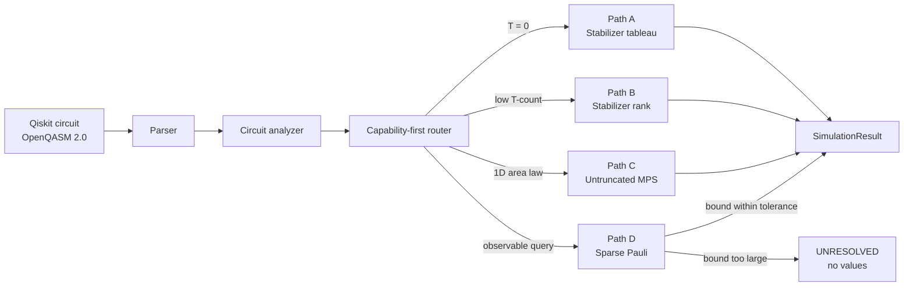
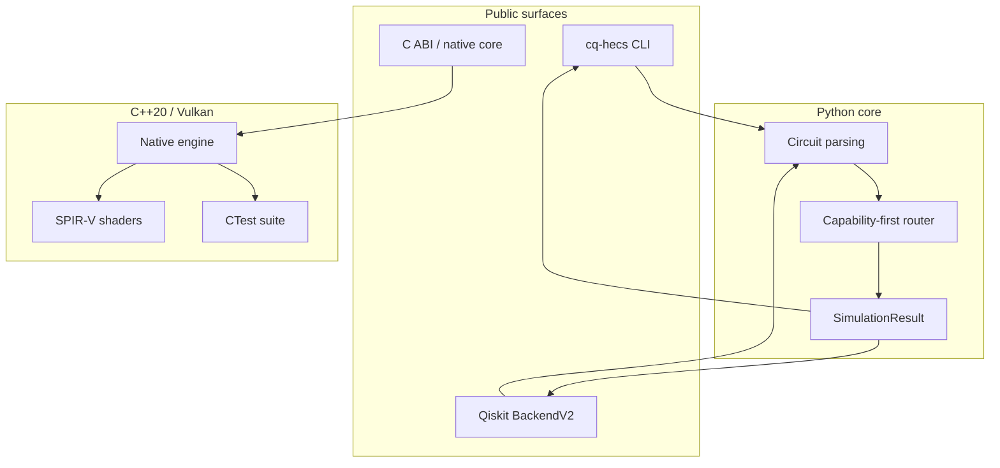

<div align="center">


# CQ-HECS

**Classical quantum-circuit simulation with explicit capability contracts.**

Four classical simulation paths · one result contract · fail-closed by design

[](https://github.com/timfromhcs/CQ-HECS/actions/workflows/ci.yml)
[](https://github.com/timfromhcs/CQ-HECS/releases)
[](https://www.python.org/)
[](https://isocpp.org/)
[](LICENSE)

[Quick start](#quick-start) ·
[Features](#features) ·
[Architecture](#architecture) ·
[Verification](#verification) ·
[Limitations](#limitations-and-non-goals) ·
[Documentation](#documentation) ·
[Contributing](#contributing)

</div>

---

> **Status: `v2.6.0` (2026-10-30).** A feature release on top of the v2.5.2
> corrections. It adds three measured surfaces, not performance claims:
>
> 1. **`M-FIT-2`** — a per-qubit noise fit from the 25 measured `r-io-7` jobs.
>    The old `OQ-02` “53 % readout error” on qubit 0 is an `X`-gate anomaly:
>    `OQ-03` reproduces it with one `X`, `OQ-09` (no `X`) does not. FIT TV
>    0.2286 → **0.1209**; held-out median ΔTV −0.0719 → **−0.1054** (16/20
>    jobs closer). Post-hoc and exploratory; `M-FIT`'s `SUPPORTED` verdict is
>    unchanged.
> 2. **CQ-HECS Studio** — a local `cq-hecs studio` UI for circuits, the noise
>    comparison, a sound SAT lab, and the measured evidence. No new runtime
>    dependencies, loopback only, no credentials.
> 3. **A sound SAT engine** — `cq-hecs sat solve|sweep`. `SAT` means a verified
>    model; `UNSAT` means exhaustive search with no proof object; a timeout is
>    `UNKNOWN`, never `UNSAT`.
>
> **Independent cross-check:** 21 noiseless circuits (GHZ widths 2–128, QFT,
> Clifford+T, brickwork, Grover, BV, DJ, mirror) agree with the QuantumRings
> simulator within finite-shot noise — **21/21 PASS**. QuantumRings is a
> classical simulator, not a QPU.
>
> The current tree passes **584 Python tests** (4 skipped, 1 opt-in slow gate)
> in **~110 s**, **19/19 CTest**, **35/35 source mutants**, and a **12-check
> metamorphic self-test**.
>
> **First measured QPU data (complete):** all 25 preregistered `r-io-7` jobs
> ran on `rigetti:cepheus-1-108q` on 2026-10-30. H-V3-8 returns
> **`SUPPORTED`** — median ΔTV = −0.071905, 95 % CI [−0.135899, −0.006703].
> A five-job, 100-shot IonQ pilot (`r-qpu-pilot-1`) spent the remaining 25
> Spark credits on the qubit-0 anomaly; it is not a confirmation run.
>
> **Not claimed:** universal quantum simulation, real-QPU execution *by this
> package*, cross-vendor GPU acceleration, SOTA performance, a proof of
> `P = NP`, or a proof of ETH. See [Limitations](#limitations-and-non-goals),
> [`research/v3/COMPLEXITY_BOUNDARY.md`](research/v3/COMPLEXITY_BOUNDARY.md)
> and [`research/v4/COMPLEXITY_AND_ETH.md`](research/v4/COMPLEXITY_AND_ETH.md).

<details>
<summary><strong>Kurzfassung (Deutsch)</strong></summary>

CQ-HECS ist ein klassischer Quantenschaltungs-Emulator mit vier Pfaden
(Stabilizer-Tableau, Stabilizer-Rank, untruncated MPS, Sparse-Pauli). Der Router
wählt den Pfad anhand der Schaltungsstruktur. Ergebnisse tragen getrennte
Fehlerklassen und einen expliziten Zustand (`EXACT`, `CERTIFIED`, `UNRESOLVED`,
`FAILED`). An Grenzen wird die Ausführung verweigert, statt ein plausibles
Ergebnis zu erfinden. Die Python-Pfade laufen auf der CPU; der Vulkan-Dispatch
wurde nur für native Primitiven auf einer AMD-Radeon-iGPU verifiziert. Es gibt
keine echte QPU-Ausführung und keine Behauptung zu `P = NP`.

</details>

---

## Table of contents

- [What is CQ-HECS?](#what-is-cq-hecs)
- [What it is not](#what-it-is-not)
- [Features](#features)
- [Quick start](#quick-start)
- [Installation](#installation)
- [Usage](#usage)
- [Architecture](#architecture)
- [Verification](#verification)
- [GPU and hardware status](#gpu-and-hardware-status)
- [Limitations and non-goals](#limitations-and-non-goals)
- [Research and real-data evidence](#research-and-real-data-evidence)
- [Project structure](#project-structure)
- [Documentation](#documentation)
- [Contributing](#contributing)
- [Security](#security)
- [Citation](#citation)
- [License](#license)

---

## What is CQ-HECS?

CQ-HECS is a router-based classical simulator for quantum circuits. It does not
try to be one algorithm for everything: it analyses the circuit, selects the
path with the right cost model, and returns a typed result that says what was
computed and what was not.

The core design rule is simple:

> A correct refusal is better than a plausible-looking wrong answer.

That rule is enforced in code, not only in documentation:

| Principle | Implementation |
| :--- | :--- |
| **No silent approximation** | No hidden bond-dimension cutoff. Discarded spectral mass is reported; where no valid bound exists, the field is `None`. |
| **No fabricated results** | Counts are never invented. Unknown gates are rejected with a typed error, never treated as identity. |
| **Named error classes** | `error_bound`, `numerical_error_bound`, and `sampling_error_bound` are separate quantities with separate meanings. |
| **Fail closed** | Invalid QASM, unknown gates, exhausted budgets, and unsupported dynamic features raise structured errors instead of returning a partial run. |
| **Honest hardware claims** | All four Python paths run on the CPU. Vulkan dispatch is verified only for native primitives on one AMD iGPU; no end-to-end GPU simulator claim. |

### At a glance

| Item | Value |
| :--- | :--- |
| **Package** | `cqhecs` (source install; not currently on PyPI) |
| **Public surfaces** | `cq-hecs` CLI, `cq-hecs studio` web UI, Qiskit `BackendV2`, Python API, C ABI, SAT engine |
| **Simulation paths** | A: stabilizer tableau · B: stabilizer rank · C: untruncated MPS · D: sparse Pauli |
| **Noise** | Typed profiles, Kraus channels, exact float64 density matrix up to 10 qubits, measured `M-FIT-2` |
| **Verification** | 584 Python tests (~110 s), 19 CTest, 35 mutants, 12-check selftest, 12 SPIR-V shaders, 21/21 independent oracle |
| **Platforms** | Linux x64, Windows 10/11; Python 3.11–3.14 |
| **License** | Apache-2.0 |

---

## What it is not

- **Not a universal quantum simulator.** Each path has a target class and a hard
  limit; no path claims polynomial-time simulation of arbitrary circuits.
- **Not a QPU.** `RealHardwareBackend` is a fail-closed boundary without a
  provider integration. This package has never executed a job on physical
  hardware. One externally submitted reference suite (`r-io-7`) produced
  measured counts that are used as evaluation data only, never as a result of
  this package.
- **Not a GPU-accelerated simulator.** The Python paths are CPU-only. Vulkan
  compute was verified for native primitives, not for end-to-end circuit
  simulation.
- **Not a symbolically exact engine.** `exact=True` means “no deliberate
  approximation step”; float64 evaluation and numerical-rank decisions remain.
- **Not a P = NP result.** P versus NP is open. No simulator, benchmark, or
  finite experiment in this repository proves or disproves it.

---

## Features

### Four simulation paths



| Path | Method | Best for | Guarantee | Hard limit |
| :--- | :--- | :--- | :--- | :--- |
| **A** | Gottesman–Knill tableau | pure Clifford circuits (`T = 0`) | exact GF(2) symplectic evolution, `error_bound = 0.0` | first non-Clifford gate escalates |
| **B** | Stabilizer-rank decomposition | low `T`-count | exact algebraic decomposition, float64 evaluation | 22 qubits (implementation ceiling) |
| **C** | Untruncated MPS | 1D area-law states | no deliberate truncation; `numerical_error_bound=None` | RAM budget (`ram_budget_mb`, fail-closed); dense conversion ≤ 20 qubits; sampling routing cap 500 qubits |
| **D** | Sparse-Pauli Heisenberg | observable queries on 200+ qubits | certified bound `Δ ≤ Σ abs(c_P)` over discarded terms | no certified joint measurement distribution |

Every `SimulationResult` carries a machine-readable state:

| State | Meaning |
| :--- | :--- |
| `EXACT` | No deliberate approximation. The arithmetic class is recorded separately in `numerical_mode`. |
| `CERTIFIED` | Approximate, with a bound on the quantity actually returned. |
| `UNRESOLVED` | Budget or tolerance exceeded; the engine refuses to guess and returns no values. |
| `FAILED` | Technical failure; never presented as success. |

### Hardware-aware noise bridge

- Versioned `BackendProfile` schema with coupling maps, basis gates, gate
  errors, readout errors, T1/T2, and calibration provenance.
- Kraus channels with completeness, trace, Hermiticity, and positivity checks.
- Exact float64 density-matrix evolution for circuits up to 10 qubits, with
  separate sampling and readout error.
- `IDEAL_CLASSICAL` / `NOISY_CLASSICAL` / `REAL_HARDWARE` execution modes.
- Real-provider boundary fails closed; it never falls back silently to
  classical simulation.
- IBM calibration import (schema 2.0) preserves non-operational gates and
  inconsistent T1/T2 as explicit flags instead of clipping them.

### Real-data reference evaluation

`cq-hecs reference` evaluates a noisy prediction against measured IBM counts
from a pinned public dataset (R-IO-5, MIT). The preregistered pooled H-V3-1
result is **INCONCLUSIVE**; the Bell+GHZ subset is reported as exploratory
only. No parameters are tuned on the evaluation set. Details:
[`research/v3/HYPOTHESES.md`](research/v3/HYPOTHESES.md).

### Metamorphic self-test

`cq-hecs selftest` runs 12 deterministic relations: normalization, `C†C = I`,
qubit-permutation equivariance, global-phase equivalence, exact MPS/dense
parity, full-unitary consistency, finite-shot Hoeffding bounds with
Bonferroni correction, Kraus/readout invariants, noisy permutation
equivariance, zero-noise identity, and channel composition order.

### Interfaces

- **CLI:** `cq-hecs` with a strict JSON contract (`--format json`).
- **Qiskit:** `BackendV2` provider, tested against Aer for supported paths.
- **Python API:** router, expectation values, profiles, reference harness.
- **Native:** C++20 core, C ABI, Vulkan compute shaders (separately built and
  tested).
- **Studio:** a local browser UI for circuits, noise, SAT and the measured
  evidence (`cq-hecs studio`).

### CQ-HECS Studio

`cq-hecs studio` starts a loopback-only experiment UI over the same engine. It
has no build step and no new runtime dependency (standard-library HTTP server +
the existing package).


- **Circuit lab:** QASM or preset, forced path, shots, seed, ideal / `M-FIT` /
  `M-FIT-2`; histogram, path decision, state and error classes.
- **Noise lab:** per-qubit fitted parameters and a measured-vs-model ΔTV table
  for every held-out `r-io-7` job.
- **SAT lab:** DIMACS or random 3-SAT, sound verdicts, and a phase-transition
  sweep.
- **Evidence:** all 25 jobs with their circuit digests and provider job IDs.
- **Research:** sourced notes on `P` versus `NP`, ETH, and the OpenAI math
  corpus, with the same non-claims as this README.

See [`docs/STUDIO.md`](docs/STUDIO.md) for the API and the security model.

### Sound SAT engine

The supported surface is `cqhecs/sat.py` and `cq-hecs sat`:

```bash
cq-hecs sat solve benchmarks/sat/pigeonhole_6_5.cnf
cq-hecs sat solve --random 30 --ratio 4.26 --timeout 5
cq-hecs sat sweep --sizes 10,15,20,25 --ratios 3.0,4.26,6.0 --trials 5
```

`SAT` means a model was found and verified clause by clause. `UNSAT` means the
search space was exhausted; no proof object is produced and the result says so.
A timeout or node budget is `UNKNOWN`, never `UNSAT`. The old
`python_bridge/sat_engine.py` demonstrator is not used by this surface: its
branch hash covers only the first 32 variables and it reports a timeout as
`UNSAT`.

---

## Quick start

### Requirements

- Python **3.11–3.14**
- Linux x64 or Windows 10/11
- Vulkan SDK **only** for the optional native core

The Python package is installed from source; it is not currently published on
PyPI.

```bash
git clone https://github.com/timfromhcs/CQ-HECS.git
cd CQ-HECS
python -m venv .venv

# Linux/macOS
source .venv/bin/activate
# Windows PowerShell: .\.venv\Scripts\Activate.ps1

python -m pip install --upgrade pip
pip install -e .
```

Verify the installation:

```bash
cq-hecs doctor
cq-hecs selftest --cases 8
cq-hecs run name:bell --shots 1000 --seed 42
cq-hecs --format json run name:bell --shots 1000
cq-hecs studio
```

`selftest` returns exit code `0` only if all 12 checks pass. It is a fast
installation check, not a proof of correctness.

### Qiskit BackendV2

```python
from qiskit import QuantumCircuit
from cqhecs.backend import CQHecsBackend

backend = CQHecsBackend(num_qubits=100)
qc = QuantumCircuit(100)
qc.h(0)
for i in range(99):
    qc.cx(i, i + 1)
qc.measure_all()

result = backend.run(qc, shots=1000).result()
print(result.get_counts())
```

---

## Installation

### Python package (CPU only)

```bash
python -m venv .venv
source .venv/bin/activate          # Windows: .\.venv\Scripts\Activate.ps1
pip install --upgrade pip
pip install -e ".[dev]"           # includes test and differential-oracle deps
```

### Native core (optional)

The native core requires CMake, a C++20 compiler, and the Vulkan SDK.

```bash
cmake -B build -DCMAKE_BUILD_TYPE=Release -DCQ_BUILD_TESTS=ON
cmake --build build --config Release
ctest --test-dir build -C Release --output-on-failure
```

Ubuntu packages:

```bash
sudo apt-get install -y cmake ninja-build g++ libvulkan-dev \
  glslang-tools vulkan-tools
```

Windows (Chocolatey):

```powershell
choco install vulkan-sdk cmake ninja -y --no-progress
.\build.bat
```

### Release artifacts

```bash
python -m build
# dist/cqhecs-2.6.0-py3-none-any.whl
# dist/cqhecs-2.6.0.tar.gz
```

Published wheels, sdists, SHA-256 checksums, and the SPDX SBOM are attached to
[GitHub Releases](https://github.com/timfromhcs/CQ-HECS/releases). The latest
release is `v2.6.0`.

---

## Usage

### CLI overview

| Command | Purpose |
| :--- | :--- |
| `cq-hecs version` | Version and runtime environment |
| `cq-hecs doctor` | OS, Python, native binding, Vulkan levels |
| `cq-hecs backend list` | Path capabilities and gate sets |
| `cq-hecs profile list` | Synthetic hardware profiles (`fake_manila`, `linear_5q`) |
| `cq-hecs profile show NAME` | Profile details and calibration provenance |
| `cq-hecs analyze name:ghz8` | Static analysis and path recommendation |
| `cq-hecs run name:bell --shots 1000` | Execute a circuit |
| `cq-hecs run name:bell --profile fake_manila` | Execute under a hardware profile |
| `cq-hecs verify name:bell --reference aer` | Compare against an independent simulator |
| `cq-hecs expect name:bell -o ZZ -o XX` | Pauli expectation values |
| `cq-hecs reference list` | Registered real-measurement datasets |
| `cq-hecs reference run --bootstrap 5000` | H-V3-1 evaluation on real IBM counts |
| `cq-hecs selftest --cases 8` | Metamorphic installation check (12 checks) |
| `cq-hecs benchmark smoke` | Reproducible smoke benchmark |

`--format json` is a **global** option and must precede the subcommand:

```bash
cq-hecs --format json run name:bell --shots 1000
```

Exit codes: `0` success, `1` unexpected error, `2` usage error, `3` unresolved,
`4` environment unavailable. The native `qasm` command uses `2` for invalid
circuit input.

### Built-in circuits

`bell`, `bell_measured`, `clifford6`, `ghz8`, `ghz8_measured`, `ghz16`,
`low_t_rank4`, `mps6`, `sparse_pauli4`, `toffoli_adder`, `qft4`, `ising6`.

### Router

```python
from qiskit import QuantumCircuit
from cqhecs.router import EntanglementAdaptiveRouter

router = EntanglementAdaptiveRouter(error_tolerance=0.01)

qc = QuantumCircuit(4)
qc.h(0)
qc.t(0)
qc.cx(0, 1)

result = router.route_and_execute(qc, shots=1000)
print(result.path, result.exact, result.error_bound, result.unresolved)
```

Forcing a path (`preferred_path="A"`) never reroutes silently. Typed capability
or resource errors are the only escalation mechanism.

### Pauli expectation values

```bash
cq-hecs expect name:bell -o ZZ -o XX -o YY          # stabilizer, exact
cq-hecs --format json expect name:ising6 -o "X0 X1"  # dense, exact (<= 22 qubits)
```

```python
from cqhecs import expectation_values

res = expectation_values(circuit, {"H": [(0.5, "ZZ"), (-1.25, "XX")]})
print(res.values, res.method, res.exact, res.error_bound)
```

| Engine | Use case | Result |
| :--- | :--- | :--- |
| `stabilizer` | Clifford circuit, up to 4096 qubits | exact `-1/0/+1` from the tableau, no sampling |
| `dense` | up to 22 qubits (hard cap 26) | exact float64 statevector, no deliberate approximation |
| `sparse_pauli` | wider non-Clifford circuits | Path D with a certified bound; otherwise `None` + `unresolved` |

`method="auto"` selects the first applicable row. Pauli strings may be dense
Qiskit labels (`IZX`, rightmost = qubit 0) or sparse (`X0 Z2`). Mid-circuit
measurement and `reset` are rejected. Values are ideal-circuit expectations,
not sampled counts.

### Path D explicitly

```python
from qiskit import QuantumCircuit
from cqhecs.backends import PathDSparsePauliBackend

qc = QuantumCircuit(3)
qc.h(0)
qc.cx(0, 1)
qc.t(0)
qc.cx(0, 2)

backend = PathDSparsePauliBackend(max_pauli_terms=512)
result = backend.execute(qc, shots=100)
print(result.expectation_values, result.error_bound)
```

Joint counts are opt-in via `allow_uncertified_joint_counts=True` and are
marked `counts_are_joint_distribution=False`; they are **not** a certified joint
distribution.

### OpenQASM contract

The Python parser and the native QASM path are fail-closed and share a
documented contract: structured `{line, category, message}` errors, global
qubit offsets for multiple registers, whole-register expansion, and a bounded
angle grammar without `eval()`.

```qasm
OPENQASM 2.0;
include "qelib1.inc";
qreg q[2];
creg c[2];
h q[0];
cx q[0], q[1];
measure q[0] -> c[0];
```

Composite gates (`u3`, `ccx`, `cy`, `rzz`, `cswap`, `iswap`, `ecr`, `c3x`, …)
are lowered exactly. Unknown gates, invalid angles, undeclared registers,
mid-circuit measurement, `reset`, and `if` are refused before execution. See
[`docs/QASM_CONTRACT.md`](docs/QASM_CONTRACT.md) for the full matrix and the
intentionally different gate ceilings of the two parsers.

---

## Architecture



| Component | Role |
| :--- | :--- |
| `cqhecs/` | Parser, lowering, analyzer, router, four backends, result contract, expectation values, hardware bridge, reference harness, selftest |
| `python_bridge/`, `python/` | Legacy reference and diagnostics; not the supported entry point |
| `src/`, `include/` | C++20 engine, C ABI, public headers |
| `shaders/` | Vulkan compute shaders (GLSL → SPIR-V) |
| `tests/` | Python, property-based, differential, and native tests |
| `research/` | Versioned evidence, hypotheses, datasets, testing notes |

A deeper component matrix is in [`ARCHITECTURE.md`](ARCHITECTURE.md) and
[`docs/ARCHITECTURE.md`](docs/ARCHITECTURE.md).

---

## Verification

The numbers below are from the current `v2.6.0` tree. They are measurements,
not performance claims. CI evidence for the exact pushed SHA is recorded in
[`research/v3/TEST_MATRIX.md`](research/v3/TEST_MATRIX.md).

| Gate | Result |
| :--- | :--- |
| Python suite | **584 passed**, 4 skipped, 1 opt-in `slow` gate (**~110 s**) |
| Branch coverage | **83 %** (CI threshold 70 %) on the `cqhecs` package |
| CTest (native) | **19/19** |
| Source mutation | **35/35** killed |
| Metamorphic selftest | **12/12** |
| SPIR-V shaders | **12/12** verified |
| Version consistency | all surfaces report `2.6.0` |
| Lint | `flake8 --select=E9,F` clean on `cqhecs`, `python_bridge`, `scripts`, `tests` |
| Silent-truncation audit | no patterns found |
| Latest CI matrix | 7/7 jobs: Linux, Windows, ASan/UBSan, Python 3.12–3.14, static/package |

### Verify it yourself

```bash
# Python
python -m pytest tests/ -q
python scripts/check_version.py
python scripts/verify_no_silent_truncation.py
python scripts/run_mutation_tests.py
cq-hecs selftest --cases 8

# Native
cmake --build build --config Release
ctest --test-dir build -C Release --output-on-failure
python scripts/verify_vulkan_shaders.py
```

> A green run on an older commit is not evidence for a later commit. The
> evidence ledger is versioned per SHA; do not copy old results into new
> release notes.

---

## GPU and hardware status

| Platform | Level | Status |
| :--- | :--- | :--- |
| Python paths (all four) | CPU | supported |
| Ubuntu CI + Mesa Lavapipe | Vulkan 1.3 SPIR-V (software ICD) | `CI_VERIFIED`; shader/pipeline conformance, no physical GPU |
| Windows headless CI | null-device guard | `CI_VERIFIED` |
| Local Windows workstation, AMD Radeon iGPU | Vulkan 1.4, AMD driver 26.6.1 | `COMPUTE_VERIFIED` historically: primitive state reset, CORDIC gate, Q30 matrix contraction; not re-run in the current audit |
| Apple Silicon, Intel Arc, NVIDIA, discrete AMD | Vulkan | `NOT_VERIFIED` |

> The Python package, CLI, and all four simulation paths are **CPU-only**. The
> verified Vulkan dispatch covers native primitive pipelines, not a
> GPU-accelerated circuit simulator. No cross-vendor compatibility or speedup
> is claimed.

### Execution modes

| Mode | Meaning |
| :--- | :--- |
| `IDEAL_CLASSICAL` | Noiseless classical simulation |
| `NOISY_CLASSICAL` | Exact float64 density matrix with a modelled noise profile (≤ 10 qubits) |
| `REAL_HARDWARE` | Physical QPU only; fails closed without explicit authorization and credentials, never silently falls back |

---

## Limitations and non-goals

- **No universal simulator.** Every path has a documented target class and hard
  limit. Worst-case cost remains exponential where it must.
- **No dynamic circuits.** Mid-circuit measurement, `reset`, and classically
  conditioned gates are refused before execution.
- **Path D returns marginals/observables, not a certified joint distribution.**
  Joint counts require an explicit opt-in and are labelled uncertified.
- **`exact=True` is not symbolic exactness.** Numerical-rank reduction (relative
  threshold `1e-13`) and float64 roundoff remain. No certified MPS error bound
  is claimed.
- **500 MPS qubits is a routing cap, not an exactness guarantee.** Entanglement,
  bond dimension, and RAM decide what actually fits.
- **The two parsers have different gate ceilings.** Both reject unimplemented
  gates; the Python side additionally knows Path-C gates and lowers composite
  gates exactly. See [`docs/QASM_CONTRACT.md`](docs/QASM_CONTRACT.md) §6.
- **Noise models are models, not hardware.** Channels attach to the gate as
  written and to the calibrated qubits; circuits are not transpiled to the
  profile basis. Uncalibrated gates remain noiseless. Both built-in profiles are
  synthetic; `fake_manila` uses the Manila topology, not its calibration values.
- **No real QPU execution by this package.** `RealHardwareBackend` is a
  fail-closed boundary; nothing in `cqhecs` submits a job. The `r-io-7` counts
  were produced by a separate, manually approved runner against Open Quantum
  and enter the repository only as a pinned evaluation dataset.
- **No cross-vendor GPU claim.** One AMD iGPU primitive dispatch was verified
  historically; current CI uses a software ICD.
- **Cloud Build is not verified here.** `cloudbuild.yaml` exists, but no
  project/credential verification was performed in this audit.
- **No P = NP claim.** The problem is open; the repository treats it as a
  complexity boundary, not an engineering target. See
  [`research/v3/COMPLEXITY_BOUNDARY.md`](research/v3/COMPLEXITY_BOUNDARY.md).

---

## Research and real-data evidence

The `research/` tree is an evidence ledger, not marketing copy. Each record is
tied to a source SHA and records `PASS`, `FAIL`, `SKIP`, `BLOCKED`, and
`INCONCLUSIVE` honestly.

| Record | Content |
| :--- | :--- |
| [`research/v2_5_2/RELEASE_AUDIT.md`](research/v2_5_2/RELEASE_AUDIT.md) | v2.5.2 release audit and artifact hashes |
| [`research/v3/V3_STABLE_PLAN.md`](research/v3/V3_STABLE_PLAN.md) | v3 plan, workstreams, gates |
| [`research/v3/DATASETS.md`](research/v3/DATASETS.md) | real-data registry, licences, SHA-256 pins, reachability |
| [`research/v3/HYPOTHESES.md`](research/v3/HYPOTHESES.md) | preregistered hypotheses and outcomes |
| [`research/v3/OPENQUANTUM_RUN_PLAN.md`](research/v3/OPENQUANTUM_RUN_PLAN.md) | preregistered 25-job real-QPU suite via Open Quantum (`r-io-7`); **25/25 executed, 2026-10-30** |
| [`research/v3/EMULATOR_BUILD_PLAN.md`](research/v3/EMULATOR_BUILD_PLAN.md) | emulator work packages derived from the measured `r-io-7` data; W1–W5 implemented in v4 |
| [`research/v4/FINDINGS.md`](research/v4/FINDINGS.md) | the `OQ-02` identification correction, `M-FIT-2`, the independent oracle, and the SAT soundness fix |
| [`research/v4/COMPLEXITY_AND_ETH.md`](research/v4/COMPLEXITY_AND_ETH.md) | `P` vs `NP`, ETH/SETH, and the OpenAI math corpus, with non-claims |
| [`research/v3/TESTING_TECHNIQUES.md`](research/v3/TESTING_TECHNIQUES.md) | property-based, metamorphic, noise-aware, and fuzzing methods |
| [`research/v3/COMPLEXITY_BOUNDARY.md`](research/v3/COMPLEXITY_BOUNDARY.md) | P vs NP status and claim boundaries |

### Current real-data result

R-IO-5 (Quantum Noise Transfer, MIT) provides real `ibm_fez` /
`ibm_marrakesh` counts and run-time calibration. The preregistered test asks
whether a device-mean noisy model is closer to the measured counts than the
ideal distribution.

| Quantity | Value |
| :--- | :--- |
| Unique reconstructible circuits | 14 (7 per backend) |
| Median ΔTV (noisy − ideal) | **−0.015660** |
| 95 % bootstrap CI | **[−0.032546, 0.000000]** |
| Pooled verdict | **INCONCLUSIVE** |
| Circuits where noisy is better | 10/14 |

QFT-on-`|0…0⟩` is maximally mixed and invariant under unital noise, so six
circuits cannot discriminate the model. The Bell+GHZ subset is reported as
**exploratory** (`SUPPORTED`, 8/8), not as a retroactive success. Missing
layout and one-qubit gate errors are documented limitations, not hidden
assumptions.

### `r-io-7`: first measured QPU reference run

The gap R-IO-5 leaves is closed by circuits this project authors itself: 25
circuits (2–5 qubits) are SHA-256-pinned in
[`research/v3/openquantum_suite/`](research/v3/openquantum_suite/) before any
submission, five FIT jobs calibrate a three-parameter model and twenty EVAL
jobs are held out for H-V3-8.

On **2026-10-30** all 25 jobs ran on `rigetti:cepheus-1-108q` through Open
Quantum, Public plan, standard queue, 1000 shots each, 1 credit per job (25 of
25 credits spent). The bit-order probe returned `00001` (qubit 0 rightmost),
so no string was reversed anywhere, and every circuit matched its pinned
SHA-256 before submission.

| Quantity | Value |
| :--- | :--- |
| FIT jobs | 5/5 completed |
| EVAL jobs | 20/20 completed |
| Verdict | **`SUPPORTED`** |
| M-FIT parameters | `p01 = 0.033`, `p10 = 0.164`, `cx = 0.00125` |
| Mean TV of the fit on the FIT jobs | 0.229 |
| Median ΔTV (noisy − ideal) | **−0.071905** |
| 95 % bootstrap CI | **[−0.135899, −0.006703]** |
| Circuits where noisy is better | 14/20 |

That verdict is narrow and it is meant to be: a three-parameter model beats
the ideal distribution on the held-out circuits **of this suite, on this
backend, on this day**. It is not a "close to real hardware" claim, and the
fit itself is mediocre (`0.229` mean TV on the five jobs it was tuned on).

Two measured facts carry beyond the verdict:

| Qubit-0 probe | circuit | marginal | reading |
| :--- | :--- | ---: | :--- |
| `OQ-01` | `X` twice (identity) | `P(1) = 0.070` | readout `P(1\|0)` |
| `OQ-02` | `X` on all five | `P(1) = 0.469` | readout **and** `X` error |
| `OQ-03` | `X` on qubit 0 only | `P(1) = 0.507` | the same flip with one `X` |
| `OQ-09` | GHZ-5, no `X` | `P(1) = 0.486` | no flip without `X` |

1. **The 53 % qubit-0 “readout error” is an `X`-gate anomaly.** A readout matrix
   would depress `OQ-09` as well; it does not. Installing `0.531` as readout
   over-corrects every GHZ circuit. `M-FIT-2` fits `p10[0]` on the padded GHZ
   ladder instead and solves an `X` bit-flip of 0.536 from `OQ-02`/`OQ-03`.
2. **Width still costs more than depth.** GHZ-5 costs 0.010 of ideal-outcome
   share when the CX count goes from 20 to 36 (`OQ-04` → `OQ-05`), while going
   from 2 to 5 qubits costs 0.197 (`OQ-06` → `OQ-09`). The fitted CX
   depolarizing parameter is 0.005, consistent with depth being a small term on
   this device.

`M-FIT-2` improves both sides of the score: FIT TV **0.2286 → 0.1209** and
held-out median ΔTV **−0.0719 → −0.1054** (16/20 jobs closer, 95 % CI
[−0.1326, −0.0425]). It is **post-hoc and exploratory**, not a preregistered
confirmation; `M-FIT` remains the frozen model whose `SUPPORTED` verdict is
reported above. Confirmation needs a fresh backend and a fresh split.

A five-job, 100-shot IonQ pilot (`r-qpu-pilot-1`) spent the remaining 25 Spark
credits on the same qubit-0 question. It is deliberately not the 25-job suite:
the full suite would have cost roughly 1,225 credits at the quoted 49 credits
per 1000-shot job. See
[`research/v4/evidence/openquantum_pilot/`](research/v4/evidence/openquantum_pilot/).

No calibration snapshot was delivered for any `r-io-7` job
(`calibration_data_url` was null), so nothing here constrains T1/T2. The raw
counts are pinned in
[`research/v3/evidence/openquantum/`](research/v3/evidence/openquantum/).

---

## Project structure

```text
CQ-HECS/
├── cqhecs/                 # Python core: parser, lowering, router, backends, result contract
│   ├── backends/           # Paths A–D and the noisy density-matrix backend
│   ├── studio/             # local experiment UI (stdlib HTTP + static app)
│   ├── sat.py              # sound DPLL, DIMACS, phase-transition sweep
│   ├── noise_fit.py        # M-FIT-2 fit from measured counts
│   ├── hardware_bridge.py  # profiles, Kraus channels, fake/real provider boundary
│   ├── calibration_import.py
│   ├── reference.py        # real-data harness (R-IO-5 / R-IO-6 registry)
│   └── selftest.py         # 12 metamorphic checks
├── python_bridge/          # legacy reference and diagnostics
├── src/                    # C++20 native core and C ABI
├── include/                # public C/C++ headers
├── shaders/                # Vulkan compute shaders (GLSL)
├── tests/                  # Python, property-based, differential, and native tests
├── docs/                   # API, architecture, QASM, embedding, benchmarks, usage
├── research/               # versioned evidence ledger
├── benchmarks/             # reproducible smoke-benchmark raw data
├── scripts/                # version, audit, build, and release tooling
└── .github/workflows/      # CI, nightly, and release pipelines
```

---

## Documentation

| Document | Content |
| :--- | :--- |
| [`ARCHITECTURE.md`](ARCHITECTURE.md) | binding architecture overview |
| [`docs/ARCHITECTURE.md`](docs/ARCHITECTURE.md) | component matrix and verification levels |
| [`docs/QASM_CONTRACT.md`](docs/QASM_CONTRACT.md) | parser grammar, error categories, exit codes |
| [`docs/API_REFERENCE.md`](docs/API_REFERENCE.md) | CLI, Python, and C ABI contracts |
| [`docs/STUDIO.md`](docs/STUDIO.md) | local UI, HTTP API, security, and provenance |
| [`docs/USAGE_GUIDE.md`](docs/USAGE_GUIDE.md) | verified commands and usage examples |
| [`docs/EMBEDDING_GUIDE.md`](docs/EMBEDDING_GUIDE.md) | C ABI embedding in C++, Python, C#, Rust |
| [`docs/BENCHMARKS.md`](docs/BENCHMARKS.md) | current and historical benchmarks |
| [`docs/V2_IMPLEMENTATION_MATRIX.md`](docs/V2_IMPLEMENTATION_MATRIX.md) | implementation status with test anchors |
| [`CHANGELOG.md`](CHANGELOG.md) · [`RELEASE_NOTES.md`](RELEASE_NOTES.md) | version history and release details |

---

## Contributing

Contributions are welcome: reproducible bug reports, correctness
counterexamples, and tests that cover an untested boundary are especially
valuable.

1. Fork the repository and create a focused branch.
2. Install development dependencies: `pip install -e ".[dev]"`.
3. Run the relevant gates from [Verification](#verification).
4. Open a pull request with reproduction steps and test results.

The project rule is non-negotiable: **no green tests at the expense of
truth**. A test that confirms a false claim is a bug.

- [`CONTRIBUTING.md`](CONTRIBUTING.md)
- [Issue templates](.github/ISSUE_TEMPLATE)
- Security reports: **do not** open a public issue; see [`SECURITY.md`](SECURITY.md)

---

## Security

Please report vulnerabilities privately as described in [`SECURITY.md`](SECURITY.md).
Do not include credentials, provider tokens, or personal data in issues,
benchmarks, or logs.

---

## Citation

If you use CQ-HECS in research or teaching, cite the repository. GitHub also
exposes a “Cite this repository” entry from [`CITATION.cff`](CITATION.cff).

```bibtex
@software{cqhecs2026,
  author  = {Stark, Tim Johann},
  title   = {CQ-HECS: Classical Quantum High-Efficiency Compute Simulator},
  version = {2.6.0},
  year    = {2026},
  url     = {https://github.com/timfromhcs/CQ-HECS},
  license = {Apache-2.0}
}
```

---

## License

CQ-HECS is licensed under the **Apache License 2.0**. See [`LICENSE`](LICENSE)
for the full text.

<div align="center">

**[Back to top](#cq-hecs)**

</div>
