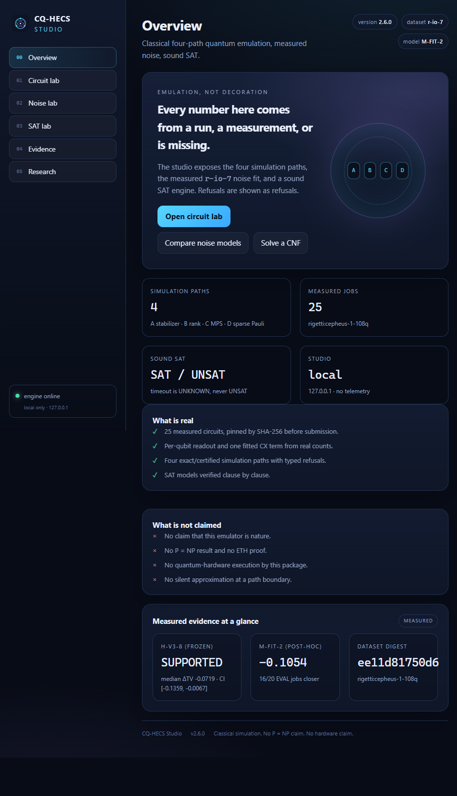

# CQ-HECS Studio

`cq-hecs studio` starts a local experiment UI. It is a thin HTTP layer over the
same engine the CLI uses: no second simulator, no hard-coded charts, no
telemetry.

```bash
pip install -e ".[dev]"
cq-hecs studio
# CQ-HECS Studio on http://127.0.0.1:8765/#token=<per-launch token>
```

Options:

```text
--host 127.0.0.1     bind address (do not expose to a network without a proxy)
--port 8765          port
--root PATH          repository root for evidence discovery
--no-browser         do not open a browser
```

The command prints a private URL whose fragment carries a per-launch API token; open
that URL (the page reads the token and removes it from the address bar). See
[Security](#security).

The server uses only the Python standard library plus the existing engine
(`numpy`, `qiskit`). There is no npm build, no CDN, and no external font.



## Labs

### Circuit lab

Type OpenQASM 2.0 or choose a preset, then pick a path (`auto`, `A`–`D`), a shot
count, a seed and a noise mode:

- `ideal` — the router's exact/certified path;
- `M-FIT` — the frozen, preregistered mean-readout model;
- `M-FIT-2` — the post-hoc per-qubit model fitted from `r-io-7`.

Noise runs use the exact density matrix and are limited to 10 qubits. Above
that the server returns a typed `noise_width_limit` refusal; it does not
approximate.

**Execution plan panel.** Below the result, `Plan circuit` sends the editor source and the selected
path to `POST /api/plan` (same bearer-token flow as every other call) and shows the dry-run
`cqhecs.execution_plan/1` document: selected path and the reason, a table of every candidate path
with capability blockers and policy notes (why each rejected path was not chosen), peak-memory and
work figures labelled `ESTIMATE` (heuristic, not guarantees), known hard limits, unsupported
operations, and the input, normalized-circuit and plan SHA-256 digests. Nothing is simulated.
Typed states: `idle` (empty message), `empty` (no source), `refused` (a forced path that cannot run
the circuit shows its refusal code, for example `FORCED_PATH_UNSUPPORTED`; it is never rerouted),
`error` (server-side invalid circuit), `plan ready`. Values are set with `textContent` only; the
button and result region are keyboard reachable. Test: `tests/test_studio_plan_ui.py` (static checks
plus a real headless Chromium run with axe at 1280 and 360 px; skipped as NOT_RUN when Node and
`web/node_modules` are absent).

### Noise lab

Shows the fitted per-qubit parameters, the FIT residual, the held-out ΔTV for
both models, and a per-job comparison against the measured counts. Select a job
to see measured vs ideal vs `M-FIT` vs `M-FIT-2` probabilities for the top
outcomes.

The model is **post-hoc and exploratory**. It was written after the 25 jobs
existed. `M-FIT-2` does not replace the frozen `M-FIT` verdict; it is a
mechanism check that needs a fresh backend for confirmation.

### SAT lab

Paste DIMACS, generate a random 3-SAT instance, or run a phase-transition sweep.
The supported engine is `cqhecs/sat.py`:

- `SAT` — a model was found and verified clause by clause;
- `UNSAT` — exhaustive search finished; a tree-resolution certificate is replay-checked (`certified`);
- `UNKNOWN` — timeout or node budget; never reported as `UNSAT`.

The engine selector offers `dpll` (built-in reference), `watched` (the same
search with two-watched-literal propagation), `cadical` (optional extra,
DRAT-checked) and `omniwave` (experimental, DRAT-checked).

The sweep is an empirical runtime curve. It is not a proof of ETH and says
nothing about `P = NP`.

### OMNIWAVE lab

Runs the experimental OMNIWAVE engine in the background and shows its live
state, polled four times a second from the running engine (nothing is
simulated for display):

- fronts processed, queue length, conflicts, shared nogoods, skipped duplicates,
  DRAT lemmas logged, exact coverage of the 2^n assignments, elapsed time;
- a chart of fronts and coverage over time;
- work per wave (with each wave's start variable) and per worker thread;
- the Vulkan device, if any, and whether it is a software ICD.

Controls: CNF or random 3-SAT (vars, ratio, seed), waves, workers, propagation
(`scalar`, `batch`, `vulkan`), batch size, timeout and front budget; Start,
Pause, Resume, Cancel. Paused time does not count against the timeout. One run
is active at a time. The verdict follows the same rules as everywhere: SAT with a
verified model, UNSAT only with an accepted DRAT proof, otherwise UNKNOWN.
Worker threads share one Python interpreter, so more workers is not a speedup.

### Quantum Gravity lab

Tab `08` hosts the Quantum Gravity Lab (BMV effective phase, small-N SYK, a bounded Z2
gauge toy) through the separately versioned `/api/qg/v1/*` routes. Every run is a finite
model on an exact classical reference; the tab never contacts a provider, never spends
credits and does not measure gravity. `Run` stays disabled until the assumptions are
confirmed; typed refusals are shown, not hidden. The Studio tab is English only (the Studio
has no i18n); the web app version is EN/DE/FR. The tab list follows the WAI-ARIA tabs pattern (roving tabindex; Left/Right/Home/End
move focus and selection); `tests/studio_ui_e2e.mjs` asserts it in a real browser. Details:
[`QUANTUM_GRAVITY_LAB.md`](QUANTUM_GRAVITY_LAB.md). Evidence: `research/v7/evidence/waveB_B3.md`.

### Evidence

The 25 `r-io-7` jobs with their SHA-256 circuit digests, provider job IDs, and
per-job TV values. Click a row to open it in the noise lab.

### Research

Short, sourced notes on `P` versus `NP`, ETH/SETH, and the OpenAI math corpus,
including the repository's own `UNVERIFIED_RESEARCH` classification of the
October 26 ETH manuscript.

## HTTP API

All responses are JSON. The server binds to loopback by default and reads no
credentials.

| method | path | body / query | purpose |
| :--- | :--- | :--- | :--- |
| `GET` | `/api/health` | — | version, dataset, model, non-claims |
| `GET` | `/api/suite` | — | 25 jobs + measured TV rows |
| `GET` | `/api/noise` | — | fitted model + evaluation |
| `GET` | `/api/preset` | `?name=bell` | QASM for a builtin |
| `GET` | `/api/research` | — | sourced research payload |
| `GET` | `/api/hardware` | — | every committed QPU evaluation (shots, verdict, ΔTV) |
| `GET` | `/api/devices` | — | measured M-FIT-2 device profiles |
| `GET` | `/api/reference` | — | registered reference datasets |
| `GET` | `/api/diagnostics` | — | execution-environment report (the probes behind `cq-hecs doctor`; nothing runs on a GPU) |
| `GET` | `/api/openapi.json` | — | this API as OpenAPI 3.1 (`schemas/studio.openapi.json`) |
| `POST` | `/api/plan` | `{source, path?, require_counts?}` (`path`: `auto` or `A`-`D`) | dry-run `cqhecs.execution_plan/1` (no simulator state allocated); same document as `cq-hecs plan` and MCP `cqhecs_plan` |
| `POST` | `/api/simulate` | `{source, shots, seed, path, noise}` (`noise`: `ideal`, `mfit`, `mfit2`, `custom`, `device:<id>`) | circuit result |
| `POST` | `/api/noise/compare` | `{job_id, overrides?}` | measured vs models |
| `POST` | `/api/sat/solve` | `{cnf}` or `{random:{...}}`, optional `engine` (`dpll`, `watched`, `cadical`, `omniwave`) | sound SAT result with `certification` |
| `POST` | `/api/sat/count` | `{cnf, timeout}` | exact #SAT count |
| `POST` | `/api/sat/sweep` | `{sizes, ratios, trials, timeout}` | empirical sweep |
| `GET` | `/api/omniwave/status` | — | live OMNIWAVE state, timeline, result, GPU status |
| `POST` | `/api/omniwave/start` | `{cnf}` or `{random:{...}}`, `waves`, `workers`, `bcp`, `branch` (`auto`, `jw`, `bfs`), `batch_size`, `seed`, `timeout`, `max_fronts` | start one background run (409 while one is active) |
| `POST` | `/api/omniwave/pause` · `resume` · `cancel` | `{}` | control the active run |
| `POST` | `/api/reload` | — | reload evidence from disk |

Every `/api/<x>` route also answers at `/api/v1/<x>` with the same guard and body; the
original paths are unchanged. The Quantum Gravity family is separate:

| method | path | purpose |
| :--- | :--- | :--- |
| `GET` | `/api/qg/v1/health` · `catalog` · `models` · `evidence` | status, method cards, model list, recorded evidence |
| `GET` | `/api/qg/v1/experiments` · `backends` | experiment families; execution surfaces and local availability |
| `GET` | `/api/qg/v1/evidence/<experiment>` | recorded evidence for one family (read-only) |
| `GET` | `/api/qg/v1/exports/<experiment>` | secret-free evidence bundle |
| `POST` | `/api/qg/v1/experiments/validate` | validate an experiment request |
| `POST` | `/api/qg/v1/experiments/preview` | deterministic QASM + SHA-256, spend = 0 |
| `POST` | `/api/qg/v1/experiments/run-local` | exact `CLASSICAL_REFERENCE` run |
| `POST` | `/api/qg/v1/experiments/plan` | QG plan envelope, identical to `cq-hecs qg plan` and MCP `cqhecs_qg_plan` |
| `POST` | `/api/qg/v1/experiments/compare` | exact BMV reference versus the CQ-HECS router |
| `POST` | `/api/qg/v1/openquantum/quote`, `/api/qg/v1/openquantum/submit` | **always a typed `403`** (`qg_paid_path_unavailable`); nothing is quoted, submitted or spent |
| `GET` | `/api/qg/v1/openquantum/jobs/<id>[/results]` | **always a typed `403`**, same document |

Example (every `/api` call needs the bearer token printed at launch):

```bash
curl -s http://127.0.0.1:8765/api/v1/simulate \
  -H "Authorization: Bearer $TOKEN" -H 'Content-Type: application/json' \
  -d '{"source":"preset:bell","shots":256,"noise":"ideal"}'
```

Limits: 1 MB request body; 20 000 shots; 10 qubits for the noisy path; 240
solver runs per sweep. Inputs outside a limit are refused with a stable error
code, not clamped.

## Data and provenance

The server looks for the measured evidence in this order:

1. `<root>/research/v3/evidence/openquantum/rigetti_cepheus-1-108q/`;
2. the packaged snapshot `cqhecs/studio/data/dataset.json`, written by
   `scripts/build_studio_data.py`.

The packaged snapshot is refused if a single TV row or the frozen model differs
from the published evaluation. The dataset digest in the published evaluation
refers to the result files as originally delivered; the committed files were
later normalised byte-for-byte. The snapshot records both digests and the
re-verification note.

## Security

- Loopback only by default. Every `/api` route requires a per-launch bearer token
  (`Authorization: Bearer ...`; or set `CQ_HECS_STUDIO_TOKEN` / `CQ_HECS_STUDIO_TOKEN_FILE`
  to choose it, which then is **not** embedded in the printed URL). A Host allow-list and an
  Origin check apply, POST bodies must be `application/json`, bodies over 1 MB are refused,
  and rejected bodies are drained under a bounded deadline. This defends a loopback server
  against cross-site POSTs and DNS rebinding; it is not a remote-service security model,
  so do not expose it to a network (`tests/test_studio_security.py`).
- Only bundled static files are served. There is no path traversal surface.
- The server never reads `quantumrings.conf`, `sdk-key-*.json`, `oq.py`, or the
  Open Quantum account store.
- Provider credentials are not part of the UI or the API.

## Non-claims

The Studio is a classical experiment surface. It is not a QPU, not a proof
assistant, not a `P = NP` result, and not a claim that the noise model is the
physical truth. Every panel says what it measured.
