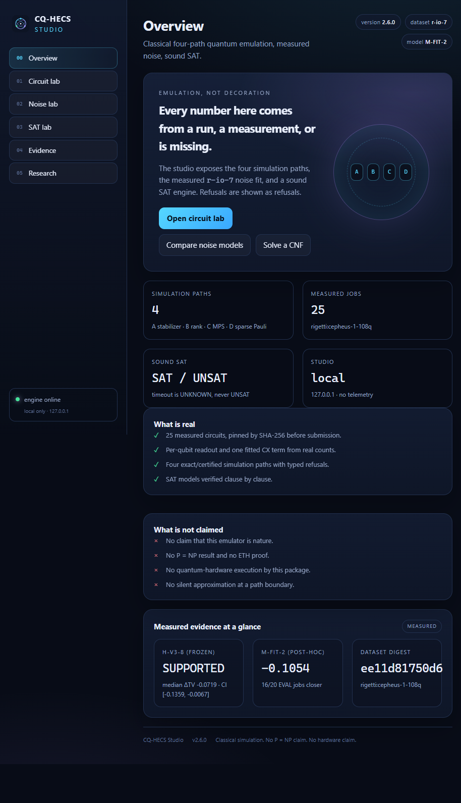

# CQ-HECS Studio

`cq-hecs studio` starts a local experiment UI. It is a thin HTTP layer over the
same engine the CLI uses: no second simulator, no hard-coded charts, no
telemetry.

```bash
pip install -e ".[dev]"
cq-hecs studio
# CQ-HECS Studio 3.1.0 on http://127.0.0.1:8765/
```

Options:

```text
--host 127.0.0.1     bind address (do not expose to a network without a proxy)
--port 8765          port
--root PATH          repository root for evidence discovery
--no-browser         do not open a browser
```

The server uses only the Python standard library plus the existing engine
(`numpy`, `qiskit`). There is no npm build, no CDN, and no external font.



## Labs

### Circuit lab

Type OpenQASM 2.0 or choose a preset, then pick a path (`auto`, `A`–`D`), a shot
count, a seed and a noise mode:

- `ideal` — the router's exact/certified path;
- `M-FIT` — the frozen, preregistered mean-readout model;
- `M-FIT-2` — the post-hoc per-qubit model fitted from `r-io-7`.

Noise runs use the exact density matrix and are limited to 10 qubits. Above
that the server returns a typed `noise_width_limit` refusal; it does not
approximate.

### Noise lab

Shows the fitted per-qubit parameters, the FIT residual, the held-out ΔTV for
both models, and a per-job comparison against the measured counts. Select a job
to see measured vs ideal vs `M-FIT` vs `M-FIT-2` probabilities for the top
outcomes.

The model is **post-hoc and exploratory**. It was written after the 25 jobs
existed. `M-FIT-2` does not replace the frozen `M-FIT` verdict; it is a
mechanism check that needs a fresh backend for confirmation.

### SAT lab

Paste DIMACS, generate a random 3-SAT instance, or run a phase-transition sweep.
The supported engine is `cqhecs/sat.py`:

- `SAT` — a model was found and verified clause by clause;
- `UNSAT` — exhaustive search finished; **no proof object** is produced;
- `UNKNOWN` — timeout or node budget; never reported as `UNSAT`.

The sweep is an empirical runtime curve. It is not a proof of ETH and says
nothing about `P = NP`.

### Evidence

The 25 `r-io-7` jobs with their SHA-256 circuit digests, provider job IDs, and
per-job TV values. Click a row to open it in the noise lab.

### Research

Short, sourced notes on `P` versus `NP`, ETH/SETH, and the OpenAI math corpus,
including the repository's own `UNVERIFIED_RESEARCH` classification of the
October 26 ETH manuscript.

## HTTP API

All responses are JSON. The server binds to loopback by default and reads no
credentials.

| method | path | body / query | purpose |
| :--- | :--- | :--- | :--- |
| `GET` | `/api/health` | — | version, dataset, model, non-claims |
| `GET` | `/api/suite` | — | 25 jobs + measured TV rows |
| `GET` | `/api/noise` | — | fitted model + evaluation |
| `GET` | `/api/preset` | `?name=bell` | QASM for a builtin |
| `GET` | `/api/research` | — | sourced research payload |
| `POST` | `/api/simulate` | `{source, shots, seed, path, noise}` | circuit result |
| `POST` | `/api/noise/compare` | `{job_id, overrides?}` | measured vs models |
| `POST` | `/api/sat/solve` | `{cnf}` or `{random:{...}}` | sound SAT result |
| `POST` | `/api/sat/sweep` | `{sizes, ratios, trials, timeout}` | empirical sweep |
| `POST` | `/api/reload` | — | reload evidence from disk |

Example:

```bash
curl -s http://127.0.0.1:8765/api/simulate \
  -H 'Content-Type: application/json' \
  -d '{"source":"preset:bell","shots":256,"noise":"ideal"}'
```

Limits: 1 MB request body; 20 000 shots; 10 qubits for the noisy path; 240
solver runs per sweep. Inputs outside a limit are refused with a stable error
code, not clamped.

## Data and provenance

The server looks for the measured evidence in this order:

1. `<root>/research/v3/evidence/openquantum/rigetti_cepheus-1-108q/`;
2. the packaged snapshot `cqhecs/studio/data/dataset.json`, written by
   `scripts/build_studio_data.py`.

The packaged snapshot is refused if a single TV row or the frozen model differs
from the published evaluation. The dataset digest in the published evaluation
refers to the result files as originally delivered; the committed files were
later normalised byte-for-byte. The snapshot records both digests and the
re-verification note.

## Security

- Loopback only by default. There is no authentication because there is no
  remote mode; use a reverse proxy with auth if you expose it.
- Only bundled static files are served. There is no path traversal surface.
- The server never reads `quantumrings.conf`, `sdk-key-*.json`, `oq.py`, or the
  Open Quantum account store.
- Provider credentials are not part of the UI or the API.

## Non-claims

The Studio is a classical experiment surface. It is not a QPU, not a proof
assistant, not a `P = NP` result, and not a claim that the noise model is the
physical truth. Every panel says what it measured.
